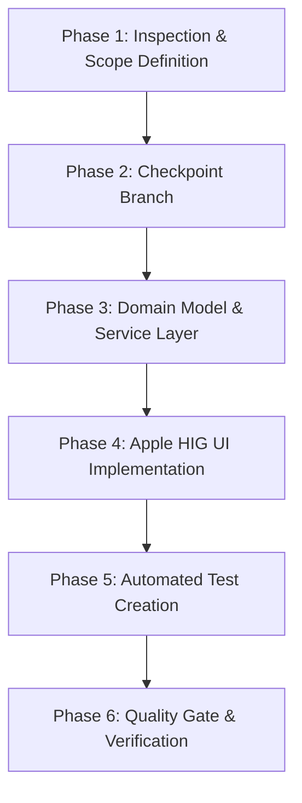

# Workflow 02: Safe Feature Implementation

> **Command**: `/safe-feature`  
> **Objective**: Implement a new feature or enhancement with zero risk of regressions, code clobbering, or architectural degradation.

---

## 1. Preconditions
- Git working directory is clean.
- Existing test suite passes 100% (`flutter test`).
- Static analysis is clean (`flutter analyze --fatal-infos --fatal-warnings`).

---

## 2. Six-Phase Execution Lifecycle



### Phase 1: Inspection & Scope Definition
1. Inspect the target domain and existing related files.
2. Confirm which tokens from `app_tokens.dart` (`NkTokens`) and models from `palette.dart` (`Palette`) will be utilized.
3. Formulate a minimal, isolated modification plan and present it to the user.

### Phase 2: Create Safety Checkpoint
Create a dedicated feature or checkpoint branch:
```powershell
git checkout -b feat/<feature-name>
```

### Phase 3: Implement Domain Models & Business Logic
1. Add new models or service methods with strict null-safety and defensive error guards.
2. If storing in Isar or Hive, ensure migration routines are backwards-compatible.
3. If synchronizing with native Android, update SharedPreferences keys (`m-*`) and MethodChannels.

### Phase 4: Implement Apple HIG UI & Android Native Surface
1. Build widgets using canonical design system components (`NkCard`, `NkListTile`, `NkButton`, `NkPillSegmentedControl`).
2. Adhere to squircle curvature (`28pt` sheets/dialogs, `16pt` cards) and touch target minima (**48×48dp**).
3. Bind semantic colors from `Palette` without hardcoded hex constants.
4. Add haptic feedback on interactions (`selectionClick`, `mediumImpact`).

### Phase 5: Write Automated Tests (Test-First Verification)
1. Create a dedicated test file under `test/` (e.g. `test/<feature_name>_test.dart`).
2. Write unit tests for business logic and widget tests for UI states (Light, Dark, AMOLED).
3. Verify test passes cleanly:
   ```powershell
   flutter test test/<feature_name>_test.dart
   ```

### Phase 6: Run Quality Gate Verification
Execute full verification:
```powershell
.\scripts\verify.ps1
```

---

## 3. Safeguards
- **Zero Clobbering**: Only append or modify targeted functions; never delete existing working methods.
- **Rollback Path**: If unexpected breakage occurs, revert cleanly to the checkpoint branch.

---

## 4. Completion Criteria
- Feature functions as specified.
- New automated tests pass.
- 100% pass across all pre-existing tests.
- Static analysis passes with 0 warnings.
- Clean conventional commit proposed.
