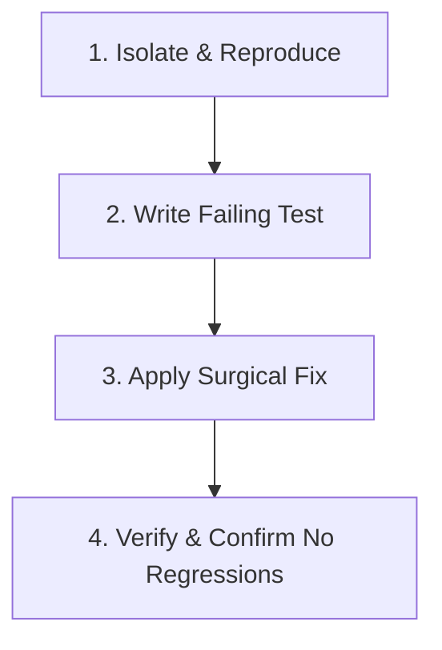

# Workflow 04: Bug Investigation & Resolution

> **Command**: `/bug-resolve`  
> **Objective**: Diagnose, isolate, reproduce, and surgically resolve a bug with zero side-effects and an automated regression test.

---

## 1. Preconditions
- A specific bug report, error log, or faulty behavior description is provided.
- Working directory is clean.

---

## 2. Four-Step Resolution Process



### Step 1: Root-Cause Isolation
1. Trace the execution path through models, controllers, services, or native Kotlin receivers.
2. Inspect log outputs and error stack traces.
3. Check against known domain invariants (`.agents/rules/11-notekar-domain-invariants.md`), such as:
   - SharedPreferences set vs list type mismatch.
   - ByteData buffer slicing corruption.
   - Contiguous session gap boundary pairing.
   - Implicit broadcast receiver registration on Android 13+.
   - Missing `Context.RECEIVER_EXPORTED`.

### Step 2: Test-Driven Reproduction (Write Failing Test)
1. Add an automated test in `test/` that mirrors the exact steps causing the defect.
2. Run the test to confirm failure:
   ```powershell
   flutter test test/<relevant_test>.dart
   ```
   Confirm the test reproduces the reported bug.

### Step 3: Surgical Patch
1. Apply the minimal necessary fix to the identified source file.
2. Do not refactor adjacent code or modify unrelated variables.
3. Ensure defensive null-checks and safe defaults are added.

### Step 4: Verification & Regression Gauntlet
1. Re-run the reproducing test:
   ```powershell
   flutter test test/<relevant_test>.dart
   ```
   Confirm the test now passes.
2. Run the full verification suite to ensure no collateral damage:
   ```powershell
   .\scripts\verify.ps1
   ```

---

## 3. Safeguards
- Never "fix" a bug by disabling the feature or commenting out the code path.
- Never "fix" a failing test by deleting the assertion.
- Keep the diff under 50 lines whenever possible.

---

## 4. Completion Criteria
- Root cause clearly explained.
- Automated test added and passing.
- Full test suite passes 100%.
- Zero analyzer warnings.
