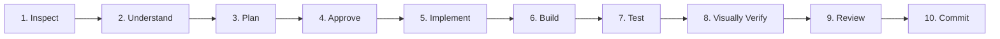

# NoteKar AI Engineering Handbook

> **Target Audience**: AI Agents (and Human Engineers) developing, maintaining, and testing NoteKar.  
> **Core Engineering Philosophy**: **Inspect → Understand → Plan → Approve → Implement → Build → Test → Visually Verify → Review → Commit**.  
> **Priority**: Producing better, more reliable, more polished software—not generating more code.

---

## 1. Prime Directives for AI Agents

As an AI agent pair-programming on NoteKar, you operate under strict engineering standards:

1. **Code Preservation Over Code Generation**:
   - **Never delete or stub out working functionality**.
   - If an existing test fails, fix your code—never delete, comment out, or weaken the test.
   - Respect battle-tested production invariants.
2. **Minimal & Isolated Modifications**:
   - Touch only the lines required for the specific task.
   - Do not perform unsolicited rewrites, refactoring, or mass formatting changes.
3. **Apple HIG Elegance × Android Native Authenticity**:
   - Strict adherence to `DESIGN_SYSTEM.md` and `NkTokens`.
   - Continuous squircle curvature (`28pt` sheets/dialogs, `16pt` cards).
   - SF/Inter typography hierarchy with tabular figures for numbers.
   - Native Android respect: Material 3 zoom transitions, Predictive Back, RemoteViews sync, monochrome notification icons (`ic_stat_notekar`).
4. **100% Offline-First & Zero Telemetry**:
   - NoteKar is air-gapped by design. No analytics SDKs, no remote tracking pixels, no telemetry pings.
   - Sovereign vaults (`.notekar-vault`) must use PBKDF2-SHA256 (>= 100k iterations) + AES-256-GCM.
5. **Quality Gates are Mandatory**:
   - Every change must pass `flutter analyze --fatal-infos --fatal-warnings` with **0 issues**.
   - Every change must pass `flutter test` with **100% success rate**.

---

## 2. Codebase Architecture & Navigation Map

```text
Notekar - Flutter/
├── lib/
│   ├── controllers/      # Business logic & state management controllers
│   ├── dialogs/          # Modal sheets, confirmation alerts, photo lightboxes
│   ├── l10n/             # Multilingual localization files (ARB)
│   ├── models/           # Isar & Hive entities, palette.dart, moment.dart
│   ├── screens/          # Primary screens (note_kar_home.dart, welcome_screen.dart)
│   ├── services/         # Storage, audio, vault encryption, mindfulness
│   ├── theme/            # app_tokens.dart (NkTokens: spacing, radii, typography)
│   ├── utils/            # app_utils.dart, date helpers, string sanitizers
│   ├── widgets/          # Reusable UI widgets & design_system/ components
│   └── main.dart         # Flutter app entry point & isolate initialization
├── android/
│   ├── app/src/main/
│   │   ├── kotlin/...    # Custom activities, services, widgets, broadcast receivers
│   │   ├── res/          # Android drawables, mipmaps, XML widget definitions
│   │   └── AndroidManifest.xml # Android permissions and component declarations
│   ├── build.gradle.kts  # Root Gradle build script
│   └── app/build.gradle.kts # App Gradle build script (SDK 36, Java 17, Proguard)
├── test/                 # 73+ comprehensive unit, widget, and lifecycle tests
├── scripts/              # Automation scripts (verify.ps1, test-all.ps1, build-release-apks.ps1)
├── .agents/
│   ├── rules/            # Permanent engineering rules (01-11)
│   ├── workflows/        # 8 standardized development workflows
│   └── skills/           # Antigravity slash commands and progressive skills
├── AGENTS.md             # Primary AI agent directive
└── DESIGN_SYSTEM.md      # Authoritative design token & component specification
```

---

## 3. The 10-Step Development Lifecycle

Every task must follow this exact lifecycle without skipping steps:



1. **Inspect**: Read relevant source files, models, and tests before writing a single line of code.
2. **Understand**: Check existing domain invariants in `.agents/rules/11-notekar-domain-invariants.md`.
3. **Plan**: Formulate a minimal, isolated modification plan.
4. **Approve**: If introducing dependencies or making potentially destructive changes, ask for user approval first.
5. **Implement**: Make surgical, clean modifications respecting `NkTokens` and null-safety.
6. **Build**: Verify the Dart / Kotlin compiler produces zero compilation errors.
7. **Test**: Run `flutter analyze` and `flutter test` (or `.\scripts\test-all.ps1 -Smoke`).
8. **Visually Verify**: Use `.\scripts\capture-screen.ps1` to inspect screens across Light, Dark, and AMOLED themes.
9. **Review**: Inspect `git diff` to ensure zero unintended changes were introduced.
10. **Commit**: Propose a clean Conventional Commit (`feat:`, `fix:`, `docs:`, `test:`, `refactor:`).

---

## 4. Key Architectural Invariants Cheat Sheet

| Domain | Invariant Rule | Rationale |
| :--- | :--- | :--- |
| **SharedPreferences** | Flutter `List<String>` is stored as a `Set<String>` in Android Kotlin. | Access via `getStringSet(key, null)` in Kotlin to prevent ClassCastException. |
| **ByteData Buffers** | Always pass offset and length: `byteData.buffer.asUint8List(byteData.offsetInBytes, byteData.lengthInBytes)`. | Omitting parameters starts from byte 0 of shared buffer, corrupting images/audio. |
| **Notifications** | Use `R.drawable.ic_stat_notekar` (monochrome vector) for small icons. Keep actions <= 8 chars and <= 3 actions. | Adaptive mipmaps crash on Samsung/Pixel; long action titles truncate. |
| **Broadcast Receivers** | Dynamic registration on API 33+ requires `Context.RECEIVER_EXPORTED`. | Android 8.0+ prohibits static implicit broadcasts; API 33 enforces export flag. |
| **Contiguous Sessions** | When Session A ends at timestamp $T$ and Session B starts at $T$, active `in` is closed by `out` at $T$, then next `in` starts Session B. | Prevents duplicate sessions or inverted timeline intervals. |
| **Untracked Gaps** | Logging an untracked gap must strictly produce a completed session (`lockToSession: true`). | Gaps represent time spans, never instantaneous single point logs. |
| **Vault Encryption** | PBKDF2-SHA256 (>= 100,000 iterations, 16-byte salt) + AES-256-GCM (12-byte IV, 128-bit tag). | Guarantees military-grade air-gapped sovereign backup security. |
| **Touch Targets** | Minimum **48×48dp** (`NkTouchTarget.minInteractive`). | Enforces TalkBack accessibility and prevents fat-finger mis-taps. |

---

## 5. Development Workflows Quick Reference

Trigger these workflows using their slash commands:

- `/app-audit`: Run full health, static analysis, lint, native Android, and security audit.
- `/safe-feature`: Staged 6-phase feature implementation with zero regressions.
- `/hig-review`: Audit UI against `NkTokens`, squircle curvature, contrast, and haptics.
- `/bug-resolve`: Reproduce bug via automated test, apply surgical fix, verify zero side-effects.
- `/test-regression`: Execute multi-tier test battery across all 73+ suites.
- `/perf-analyze`: Profile frame timing (< 16.6ms), rebuilds, memory leaks, and wake locks.
- `/security-audit`: Verify air-gap, zero telemetry, vault encryption, and Android IPC flags.
- `/release-ready`: Version sync, changelog update, multi-ABI signed APK builds, and SHA-256 hashes.

---

## 6. Daily Verification Commands

```powershell
# Quick smoke test pass
.\scripts\test-all.ps1 -Smoke

# Full verification gate (Format + Analyze + All Tests)
.\scripts\verify.ps1

# Capture screenshot on connected device or emulator for Visual QA
.\scripts\capture-screen.ps1 -Tag "home_light"

# Build signed multi-ABI release APKs
.\scripts\build-release-apks.ps1
```

---

## 7. Strict Do's and Don'ts

### DO:
- **DO** use `ContinuousSquircleBorder` and `NkRadii.card` (16pt) / `NkRadii.sheet` (28pt).
- **DO** use OpenType tabular figures (`.withTabularFigures()`) on all numeric data.
- **DO** bind colors dynamically from `palette` (`p.bg`, `p.surface`, `p.text`, etc.).
- **DO** test changes on both light and dark themes.
- **DO** write an automated test in `test/` for every new feature or bug fix.
- **DO** create safety checkpoints with `git checkout -b checkpoint/...` before major surgeries.

### DON'T:
- **DON'T** delete or comment out existing working code or tests.
- **DON'T** introduce third-party packages to `pubspec.yaml` without explicit user permission.
- **DON'T** add network analytics, tracking SDKs, or cloud dependencies.
- **DON'T** hardcode raw hex colors (`Color(0xFF...)`) in presentation components.
- **DON'T** use `BorderRadius.circular(10)` or non-standard radii.
- **DON'T** use `git reset --hard` or `git clean -fd` without user approval.
- **DON'T** ignore static analysis warnings or test failures.
