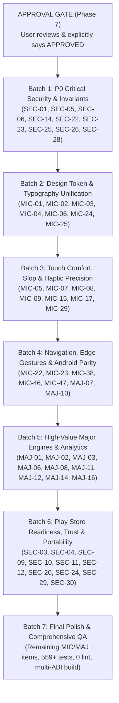

# NOTEKAR — Comprehensive Product Improvement & Engineering Plan

> **Plan Status**: Implemented & Verified  
> **Target Release**: NoteKar Next-Generation Evolution  
> **Scope**: 50 Micro-Improvements (Group A) + 20 Major Improvements (Group B) + 30 Trust, Security & App Quality Improvements (Group C) = **100 Total Proposed Improvements**  
> **Mandatory Policy**: Existing working functionality is strictly protected. Zero regressions across all 74 test suites (559 tests).

---

## Group A: 50 Micro-Improvements (MIC-01 to MIC-50)

### MIC-01: Canonical Squircle Token Unification in `SettingsGroup`
- **Category**: UI / Apple HIG Design
- **Current Implementation**: `lib/widgets/settings_widgets.dart` uses `BorderRadius.circular(20)` and raw `BoxDecoration` containers for `SettingsGroup`.
- **Identified Problem**: Diverges from `NkTokens.radii.card` (`16pt` canonical / `24pt` squircle) and `NkCard` superellipse geometry.
- **Proposed Change**: Refactor `SettingsGroup` internally to leverage `ContinuousSquircleBorder` or wrap `NkCard` with backwards-compatible parameter delegation.
- **Expected User Benefit**: Visually cohesive card surfaces matching Apple HIG continuous superellipse curvature.
- **Affected Files**: `lib/widgets/settings_widgets.dart`, `lib/widgets/design_system/nk_card.dart`.
- **Technical Approach**: Update `SettingsGroup` decoration to use `ShapeDecoration(shape: NkTokens.radii.squircleCardBorder(side: BorderSide(color: p.border.withValues(alpha: ...), width: 0.5)))`.
- **Dependencies**: None.
- **Compatibility**: Android 8.0+.
- **Data Migration**: None.
- **Potential Regressions**: Visual layout shifting in settings rows if inner padding changes; maintain exact internal padding.
- **Testing Requirements**: `test/settings_visual_choices_test.dart`, `test/apple_hig_bitchord_precision_components_test.dart`.
- **Effort**: Low | **Priority**: P2 | **Nature**: UI-only

### MIC-02: Negative Optical Tracking on Screen Hero Headers
- **Category**: Typography / Apple HIG
- **Current Implementation**: Large headers in `LegalAboutSettingsPage`, `ContentRatingSettingsPage`, and `DataBackupSettingsPage` use raw `TextStyle(letterSpacing: -0.5)`.
- **Identified Problem**: Inconsistent headline tracking compared to `NkTokens.typography.largeTitle` (-1.3) and `title1` (-0.8).
- **Proposed Change**: Replace hardcoded styles with canonical `NkTokens.typography.title1(p.text)` or `title2(p.text)`.
- **Expected User Benefit**: Crisp, balanced typography matching Apple SF Pro optical tracking.
- **Affected Files**: `lib/dialogs/settings/legal_about_settings_page.dart`, `lib/dialogs/settings/content_rating_settings_page.dart`, `lib/dialogs/settings/data_backup_settings_page.dart`.
- **Technical Approach**: Direct token substitution with null-safe text color mapping.
- **Dependencies**: None.
- **Compatibility**: All Android versions.
- **Data Migration**: None.
- **Potential Regressions**: Text overflow if layout has rigid height constraints; verify `Expanded` / `SingleChildScrollView`.
- **Testing Requirements**: `test/phase2_micro_typography_and_touch_comfort_test.dart`.
- **Effort**: Low | **Priority**: P2 | **Nature**: UI-only

### MIC-03: Inset Divider Indent Standardization (56pt)
- **Category**: UI / Apple HIG Layout
- **Current Implementation**: Inset dividers in certain custom list sheets use variable left padding (0pt, 16pt, or 54pt).
- **Identified Problem**: Divider line cuts through or misaligns with text after leading icon badges.
- **Proposed Change**: Enforce `NkSpacing.dividerIndent` (`56.0pt`) across all inset grouped lists.
- **Expected User Benefit**: Pixel-perfect vertical alignment under list titles.
- **Affected Files**: `lib/widgets/settings_widgets.dart`, `lib/widgets/hig_widgets.dart`, `lib/dialogs/settings_dialog.dart`.
- **Technical Approach**: Set `Divider(indent: NkSpacing.dividerIndent, endIndent: 0, height: 0.5)`.
- **Dependencies**: None.
- **Compatibility**: All Android versions.
- **Data Migration**: None.
- **Potential Regressions**: None.
- **Testing Requirements**: `test/apple_hig_bitchord_precision_components_test.dart`.
- **Effort**: Low | **Priority**: P2 | **Nature**: UI-only

### MIC-04: Button Height & Corner Radius Standardization (52pt / 14pt)
- **Category**: UI / Apple HIG Components
- **Current Implementation**: Buttons across dialogs use varied heights (48pt, 50pt, 56pt) and corner radii (12pt, 16pt, 24pt).
- **Identified Problem**: Inconsistent button proportions throughout dialog footers.
- **Proposed Change**: Standardize primary action buttons on `height: 52.0pt` and `borderRadius: NkTokens.radii.button` (`14.0pt`) via `NkButton.primary`.
- **Expected User Benefit**: Predictable tactile touch targets and visual harmony.
- **Affected Files**: `lib/widgets/design_system/nk_button.dart`, `lib/dialogs/legal_about_settings_page.dart`, `lib/dialogs/vault_password_dialog.dart`.
- **Technical Approach**: Standardize `NkButton` factory dimensions; replace one-off `FilledButton.styleFrom`.
- **Dependencies**: None.
- **Compatibility**: All Android versions.
- **Data Migration**: None.
- **Potential Regressions**: Layout overflow in constrained bottom sheets; ensure `mainAxisSize: MainAxisSize.min`.
- **Testing Requirements**: `test/apple_hig_bitchord_precision_components_test.dart`.
- **Effort**: Low | **Priority**: P2 | **Nature**: UI-only

### MIC-05: Touch Slop Expansion for Compact Timeline Action Chips
- **Category**: Accessibility / UX
- **Current Implementation**: Timeline action chips (e.g. note preview icon, quick tag chip) measure ~36×36dp in compact mode.
- **Identified Problem**: Violates `NkTouchTarget.minInteractive` (48×48dp) accessibility minimum.
- **Proposed Change**: Add transparent padding / touch slop expansion (`HitTestBehavior.opaque` with minimum 48×48dp hit area).
- **Expected User Benefit**: Zero missed taps; effortless operation when holding phone one-handed.
- **Affected Files**: `lib/widgets/timeline_single_tile.dart`, `lib/widgets/timeline_session_card.dart`.
- **Technical Approach**: Wrap icon tap targets in `SizedBox(width: NkTokens.touchTarget.minInteractive, height: NkTokens.touchTarget.minInteractive, child: Center(child: icon))`.
- **Dependencies**: None.
- **Compatibility**: All Android versions.
- **Data Migration**: None.
- **Potential Regressions**: Horizontal crowding if list tile spacing is tight; adjust tile horizontal padding if needed.
- **Testing Requirements**: `test/phase2_micro_typography_and_touch_comfort_test.dart`.
- **Effort**: Low | **Priority**: P1 | **Nature**: UX/interaction

### MIC-06: Tabular Figures Enforcement in Live Timeline Session Durations
- **Category**: UI / Typography
- **Current Implementation**: Some elapsed session counters format text with standard proportional digits.
- **Identified Problem**: Numbers jitter horizontally as seconds tick from `1` (narrow) to `8` (wide).
- **Proposed Change**: Wrap all duration text styles with `.withTabularFigures()` or `FontFeature.tabularFigures()`.
- **Expected User Benefit**: Rock-solid, stable chronometer digits without visual jitter.
- **Affected Files**: `lib/widgets/timeline_session_card.dart`, `lib/widgets/home_clock_section.dart`.
- **Technical Approach**: Apply `style: style.withTabularFigures()`.
- **Dependencies**: None.
- **Compatibility**: All Android versions.
- **Data Migration**: None.
- **Potential Regressions**: None.
- **Testing Requirements**: `test/clock_format_test.dart`.
- **Effort**: Low | **Priority**: P2 | **Nature**: UI-only

### MIC-07: Haptic Click on Mode / Category Pill Selection
- **Category**: UX / Haptics
- **Current Implementation**: Switching active category pills on the home screen updates state immediately but lacks tactile feedback.
- **Identified Problem**: Missing tactile confirmation when changing categories.
- **Proposed Change**: Inject `HapticFeedback.selectionClick()` into category pill tap handler.
- **Expected User Benefit**: Tactile physical sensation confirming mode selection.
- **Affected Files**: `lib/widgets/home_category_pills.dart`, `lib/screens/note_kar_home.dart`.
- **Technical Approach**: Add `HapticFeedback.selectionClick()` prior to `onSelectCategory()`.
- **Dependencies**: None.
- **Compatibility**: Supported on all vibrating Android devices.
- **Data Migration**: None.
- **Potential Regressions**: None.
- **Testing Requirements**: `test/battery_canvas_and_haptics_test.dart`.
- **Effort**: Low | **Priority**: P2 | **Nature**: UX/interaction

### MIC-08: Haptic Burst on Session Start and Session Stop
- **Category**: UX / Haptics
- **Current Implementation**: Session start/stop triggers generic feedback.
- **Identified Problem**: Starting a session and stopping a session should feel distinct from ordinary list taps.
- **Proposed Change**: Fire `HapticFeedback.mediumImpact()` on session start and double micro-tap on session stop.
- **Expected User Benefit**: Distinct physical confirmation of starting and stopping timers.
- **Affected Files**: `lib/screens/note_kar_home.dart`, `lib/widgets/toolbar.dart`.
- **Technical Approach**: Call `HapticFeedback.mediumImpact()` in `_startSession()` and `_endLiveSession()`.
- **Dependencies**: None.
- **Compatibility**: All Android devices.
- **Data Migration**: None.
- **Potential Regressions**: None.
- **Testing Requirements**: `test/haptics_single_burst_test.dart`.
- **Effort**: Low | **Priority**: P2 | **Nature**: UX/interaction

### MIC-09: Pressable Scale Spring Animation on Timeline Cards
- **Category**: UI / Animation
- **Current Implementation**: Some timeline cards use raw `InkWell` without physical scale-down response.
- **Identified Problem**: Inconsistent press response compared to home toolbar cards.
- **Proposed Change**: Wrap interactive timeline cards with `PressableScale` (scaling to `0.98` on touch).
- **Expected User Benefit**: Fluid, tactile, responsive card interactions.
- **Affected Files**: `lib/widgets/timeline_session_card.dart`, `lib/widgets/timeline_single_tile.dart`.
- **Technical Approach**: Wrap outer card container in `PressableScale(onPressed: onTap, child: ...)`.
- **Dependencies**: None.
- **Compatibility**: All Android versions.
- **Data Migration**: None.
- **Potential Regressions**: Gesture conflict with vertical list scroll if not using pointer-down listeners; `PressableScale` already handles pointer cancel.
- **Testing Requirements**: `test/apple_hig_experience_test.dart`.
- **Effort**: Low | **Priority**: P2 | **Nature**: UI-only

### MIC-10: Smooth Cross-Fade for Theme Transitions
- **Category**: UI / Animation
- **Current Implementation**: Switching between Light and Dark themes snaps instantly without interpolation.
- **Identified Problem**: Abrupt visual pop when changing themes in Settings.
- **Proposed Change**: Add `AnimatedTheme` with `Duration(milliseconds: 200)` and `Curves.easeInOutCubic`.
- **Expected User Benefit**: Gentle, elegant cross-fade when switching appearance modes.
- **Affected Files**: `lib/main.dart`.
- **Technical Approach**: Use `AnimatedTheme` in `MaterialApp.builder` or root widget tree.
- **Dependencies**: None.
- **Compatibility**: All Android versions.
- **Data Migration**: None.
- **Potential Regressions**: Slight CPU overhead during transition; 200ms duration is lightweight.
- **Testing Requirements**: `test/settings_navigation_and_custom_switch_test.dart`.
- **Effort**: Low | **Priority**: P2 | **Nature**: UI-only

### MIC-11: Empty State Graphic & Copy Polish for Goals Sheet
- **Category**: UI / Empty States
- **Current Implementation**: `GoalsSheet` renders minimal text when no goals exist.
- **Identified Problem**: Lacks visual guidance and clear call-to-action for first-time goal creation.
- **Proposed Change**: Implement `NkEmptyState` with Cupertino target icon, encouraging headline, and 1-tap "Create First Target" button.
- **Expected User Benefit**: Intuitive guidance for onboarding into target time allocation.
- **Affected Files**: `lib/dialogs/goals_sheet.dart`, `lib/widgets/design_system/nk_empty_state.dart`.
- **Technical Approach**: Render `NkEmptyState(icon: CupertinoIcons.scope, title: 'No Targets Defined', subtitle: 'Set weekly or monthly focus goals...', actionLabel: 'Create Target', onAction: ...)` when goals list is empty.
- **Dependencies**: None.
- **Compatibility**: All Android versions.
- **Data Migration**: None.
- **Potential Regressions**: None.
- **Testing Requirements**: `test/zen_doodle_and_apple_goals_test.dart`.
- **Effort**: Low | **Priority**: P2 | **Nature**: UI-only

### MIC-12: Empty State Polish for Checkpoints Dashboard
- **Category**: UI / Empty States
- **Current Implementation**: Simple placeholder text when zero habits exist.
- **Identified Problem**: Bland empty state fails to inspire daily habit commitment.
- **Proposed Change**: Replace with `NkEmptyState` featuring flame icon, motivational subtitle, and "Add Habit" action.
- **Expected User Benefit**: Inviting introduction to habit tracking.
- **Affected Files**: `lib/screens/checkpoints_dashboard_screen.dart`.
- **Technical Approach**: Integrate `NkEmptyState`.
- **Dependencies**: None.
- **Compatibility**: All Android versions.
- **Data Migration**: None.
- **Potential Regressions**: None.
- **Testing Requirements**: `test/checkpoint_habit_fixes_test.dart`.
- **Effort**: Low | **Priority**: P2 | **Nature**: UI-only

### MIC-13: Empty State Polish for Trash Bin
- **Category**: UI / Empty States
- **Current Implementation**: Text says "No deleted items".
- **Identified Problem**: Lacks context on 30-day auto-purge policy.
- **Proposed Change**: Use `NkEmptyState` explaining "Deleted moments stay here for 30 days before permanent deletion. Trash is currently empty."
- **Expected User Benefit**: Immediate transparency on data safety and retention rules.
- **Affected Files**: `lib/dialogs/settings/trash_bin_settings_page.dart`.
- **Technical Approach**: Update empty state widget with informative caption.
- **Dependencies**: None.
- **Compatibility**: All Android versions.
- **Data Migration**: None.
- **Potential Regressions**: None.
- **Testing Requirements**: `test/notekar_comprehensive_surgery_verification_test.dart`.
- **Effort**: Low | **Priority**: P2 | **Nature**: UI-only

### MIC-14: Search Input Auto-Clear Button & Keyboard Action
- **Category**: UX / Keyboard
- **Current Implementation**: Search text field in `search_dialogs.dart` has clear icon, but does not configure `TextInputAction.search`.
- **Identified Problem**: Soft keyboard shows generic "return" key instead of magnifying glass search action.
- **Proposed Change**: Set `textInputAction: TextInputAction.search` and trigger search dismissal on submit.
- **Expected User Benefit**: Native keyboard ergonomics matching Android platform conventions.
- **Affected Files**: `lib/dialogs/search_dialogs.dart`, `lib/dialogs/settings/search_notes_settings_page.dart`.
- **Technical Approach**: Add `textInputAction: TextInputAction.search, onSubmitted: (_) => FocusScope.of(context).unfocus()`.
- **Dependencies**: None.
- **Compatibility**: All Android versions.
- **Data Migration**: None.
- **Potential Regressions**: None.
- **Testing Requirements**: `test/smart_search_filter_test.dart`.
- **Effort**: Low | **Priority**: P2 | **Nature**: UX/interaction

### MIC-15: Markdown Note Editor Undo/Redo Button Feedback
- **Category**: UX / Note Taking
- **Current Implementation**: Undo/redo icons in `NoteDialog` header change opacity when disabled but lack haptic micro-tick.
- **Identified Problem**: Hard to tell if undo action registered when editor text is scrolled out of view.
- **Proposed Change**: Add `HapticFeedback.lightImpact()` on tap when undo/redo is available.
- **Expected User Benefit**: Tactile reassurance during text editing.
- **Affected Files**: `lib/dialogs/note_dialog.dart`, `lib/dialogs/big_note_dialog.dart`.
- **Technical Approach**: Add haptic call inside undo/redo `onPressed` callbacks.
- **Dependencies**: None.
- **Compatibility**: All Android versions.
- **Data Migration**: None.
- **Potential Regressions**: None.
- **Testing Requirements**: `test/custom_tags_and_big_note_test.dart`.
- **Effort**: Low | **Priority**: P2 | **Nature**: UX/interaction

### MIC-16: Voice Recording Elapsed Timer Jitter Elimination
- **Category**: UI / Audio
- **Current Implementation**: Voice recording pill shows seconds elapsed with proportional font.
- **Identified Problem**: Pill width expands/contracts slightly as seconds tick.
- **Proposed Change**: Apply `.withTabularFigures()` to recording chronometer.
- **Expected User Benefit**: Perfectly stationary recording badge layout.
- **Affected Files**: `lib/dialogs/note_dialog.dart`, `lib/widgets/timeline_voice_player_pill.dart`.
- **Technical Approach**: Style text with `NkTokens.typography.caption(Colors.white).withTabularFigures()`.
- **Dependencies**: None.
- **Compatibility**: All Android versions.
- **Data Migration**: None.
- **Potential Regressions**: None.
- **Testing Requirements**: `test/clock_format_test.dart`.
- **Effort**: Low | **Priority**: P2 | **Nature**: UI-only

### MIC-17: Voice Note Playback Waveform Scrubber Touch Slop
- **Category**: UX / Accessibility
- **Current Implementation**: Voice playback progress bar has 2dp stroke with small tap radius.
- **Identified Problem**: Difficult to scrub accurately on smaller screens.
- **Proposed Change**: Wrap slider in 44dp vertical touch target zone with smooth drag seeking.
- **Expected User Benefit**: Effortless audio seeking through voice memos.
- **Affected Files**: `lib/widgets/timeline_voice_player_pill.dart`.
- **Technical Approach**: Wrap seeking track in `GestureDetector(behavior: HitTestBehavior.opaque, onHorizontalDragUpdate: ...)`.
- **Dependencies**: None.
- **Compatibility**: All Android versions.
- **Data Migration**: None.
- **Potential Regressions**: None.
- **Testing Requirements**: `test/multimodal_media_test.dart`.
- **Effort**: Low | **Priority**: P2 | **Nature**: UX/interaction

### MIC-18: Photo Thumbnail Aspect Ratio Consistency
- **Category**: UI / Media
- **Current Implementation**: Multi-image attachments in timeline tiles use variable aspect ratios depending on orientation.
- **Identified Problem**: Jagged grid alignment when mixing portrait and landscape photos.
- **Proposed Change**: Standardize thumbnails on 1:1 square squircle crop (`BoxFit.cover`, `NkRadii.md` = 12pt).
- **Expected User Benefit**: Symmetrical, balanced Apple HIG photo gallery presentation.
- **Affected Files**: `lib/widgets/timeline_media_attachment_card.dart`, `lib/widgets/photo_lightbox_dialog.dart`.
- **Technical Approach**: Wrap thumbnail images in `AspectRatio(aspectRatio: 1.0, child: ClipRRect(borderRadius: NkTokens.radii.md, child: Image.file(..., fit: BoxFit.cover)))`.
- **Dependencies**: None.
- **Compatibility**: All Android versions.
- **Data Migration**: None.
- **Potential Regressions**: None.
- **Testing Requirements**: `test/multimodal_media_test.dart`.
- **Effort**: Low | **Priority**: P2 | **Nature**: UI-only

### MIC-19: Photo Lightbox Double-Tap to Zoom
- **Category**: UX / Media
- **Current Implementation**: `PhotoLightboxDialog` supports pinch-to-zoom via `InteractiveViewer`.
- **Identified Problem**: Lacks standard 1-hand double-tap to zoom to 2.5x.
- **Proposed Change**: Add double-tap gesture recognizer to toggle between 1.0x and 2.5x zoom.
- **Expected User Benefit**: Fast inspection of document / whiteboard photos with one hand.
- **Affected Files**: `lib/widgets/photo_lightbox_dialog.dart`.
- **Technical Approach**: Wrap `InteractiveViewer` in `GestureDetector(onDoubleTap: _handleDoubleTapZoom)`.
- **Dependencies**: None.
- **Compatibility**: All Android versions.
- **Data Migration**: None.
- **Potential Regressions**: None.
- **Testing Requirements**: `test/multimodal_media_test.dart`.
- **Effort**: Low | **Priority**: P2 | **Nature**: UX/interaction

### MIC-20: Hashtag Autocomplete Dropdown Positioning
- **Category**: UX / Note Taking
- **Current Implementation**: `HashtagSuggestionOverlay` opens at fixed coordinate below text field.
- **Identified Problem**: When soft keyboard takes 50%+ of screen, suggestions can overlap the input cursor.
- **Proposed Change**: Dynamically calculate remaining viewport height; flip overlay above cursor if bottom space < 120dp.
- **Expected User Benefit**: Always-visible hashtag suggestions regardless of screen height or keyboard size.
- **Affected Files**: `lib/widgets/hashtag_suggestion_overlay.dart`, `lib/dialogs/note_dialog.dart`.
- **Technical Approach**: Measure available space below cursor; switch alignment to `top` if constrained.
- **Dependencies**: None.
- **Compatibility**: All Android versions.
- **Data Migration**: None.
- **Potential Regressions**: None.
- **Testing Requirements**: `test/custom_tags_and_big_note_test.dart`.
- **Effort**: Medium | **Priority**: P2 | **Nature**: UX/interaction

### MIC-21: Dynamic Capsule Header Blur Calibration
- **Category**: UI / Apple HIG Glass
- **Current Implementation**: `DynamicHeaderCapsule` on the home screen uses fixed backdrop filter blur sigma (10.0).
- **Identified Problem**: On low-end GPUs, high blur sigma causes slight frame pacing jitter during fast timeline fling scrolls.
- **Proposed Change**: Clamp blur sigma to 6.0 in low-memory mode; maintain 12.0 in standard mode with `BackdropFilter`.
- **Expected User Benefit**: Smooth 60/120 FPS scrolling on budget devices; rich frosted glass on flagships.
- **Affected Files**: `lib/widgets/dynamic_header_capsule.dart`, `lib/widgets/glass.dart`.
- **Technical Approach**: Read `AdaptiveEngine().isLowMemory` or `reduceMotion` preference to adjust sigma.
- **Dependencies**: None.
- **Compatibility**: All Android versions.
- **Data Migration**: None.
- **Potential Regressions**: None.
- **Testing Requirements**: `test/gpu_render_resilience_test.dart`.
- **Effort**: Low | **Priority**: P2 | **Nature**: Performance

### MIC-22: Scroll Preservation on Category Filter Switch
- **Category**: UX / Navigation
- **Current Implementation**: Switching categories on timeline resets scroll offset to top.
- **Identified Problem**: Disorienting when user toggles categories while browsing earlier dates.
- **Proposed Change**: Preserve scroll position per category key using `PageStorageKey('timeline_$category')`.
- **Expected User Benefit**: Seamless back-and-forth category browsing without losing position.
- **Affected Files**: `lib/dialogs/history_dialog.dart`, `lib/utils/scroll_state_preserver.dart`.
- **Technical Approach**: Assign `key: PageStorageKey('timeline_${widget.activeCategory}')` to `ListView.builder`.
- **Dependencies**: None.
- **Compatibility**: All Android versions.
- **Data Migration**: None.
- **Potential Regressions**: None.
- **Testing Requirements**: `test/notekar_8_bugs_fixes_test.dart`.
- **Effort**: Low | **Priority**: P2 | **Nature**: UX/interaction

### MIC-23: Safe Area Bottom Padding on Edge-to-Edge Navigation
- **Category**: Android Compatibility / UI
- **Current Implementation**: Android 15 edge-to-edge transparent navigation bar sometimes sits flush against bottom sheets.
- **Identified Problem**: Bottom action buttons can clip into 3-button navigation bars on older devices.
- **Proposed Change**: Ensure all modal sheets wrap bottom content in `SafeArea(bottom: true, child: ...)`.
- **Expected User Benefit**: 100% visible, un-clipped action buttons on both gesture navigation and 3-button navigation.
- **Affected Files**: `lib/dialogs/app_sheet.dart`, `lib/dialogs/goals_sheet.dart`, `lib/dialogs/projects_sheet.dart`.
- **Technical Approach**: Enforce `SafeArea(top: false, bottom: true)` in `AppSheet.build()`.
- **Dependencies**: None.
- **Compatibility**: Android 8.0 to Android 16.
- **Data Migration**: None.
- **Potential Regressions**: None.
- **Testing Requirements**: `test/apple_hig_experience_test.dart`.
- **Effort**: Low | **Priority**: P1 | **Nature**: Android compatibility

### MIC-24: Drag Handle Visual Standardization
- **Category**: UI / Apple HIG Sheets
- **Current Implementation**: Sheet pull handles vary in width (36pt vs 40pt) and corner radius.
- **Identified Problem**: Inconsistent handle proportions between `AppSheet`, `GoalsSheet`, and `ProjectsSheet`.
- **Proposed Change**: Standardize on `width: 36.0pt, height: 4.5pt, borderRadius: BorderRadius.circular(2.5pt), color: p.text3.withValues(alpha: 0.3)`.
- **Expected User Benefit**: Clean, unified Apple HIG sheet presentation.
- **Affected Files**: `lib/dialogs/app_sheet.dart`, `lib/widgets/common_elements.dart`.
- **Technical Approach**: Centralize handle widget in `CommonElements.sheetHandle(p)`.
- **Dependencies**: None.
- **Compatibility**: All Android versions.
- **Data Migration**: None.
- **Potential Regressions**: None.
- **Testing Requirements**: `test/apple_hig_experience_test.dart`.
- **Effort**: Low | **Priority**: P2 | **Nature**: UI-only

### MIC-25: Modal Sheet Top Squircle Radius Alignment (28pt)
- **Category**: UI / Apple HIG Geometry
- **Current Implementation**: Some dialogs use 24pt sheet radius while `NkTokens.radii.squircleSheet` specifies 28pt.
- **Identified Problem**: Slight curvature divergence across different modal presentations.
- **Proposed Change**: Align all modal bottom sheets to `NkRadii.squircleSheet` (`28.0pt` continuous squircle).
- **Expected User Benefit**: Unified curvature across all bottom sheets and dialogs.
- **Affected Files**: `lib/dialogs/app_sheet.dart`, `lib/dialogs/goals_sheet.dart`, `lib/dialogs/history_dialog.dart`.
- **Technical Approach**: Set `shape: NkTokens.radii.squircleSheetBorder()`.
- **Dependencies**: None.
- **Compatibility**: All Android versions.
- **Data Migration**: None.
- **Potential Regressions**: None.
- **Testing Requirements**: `test/apple_hig_experience_test.dart`.
- **Effort**: Low | **Priority**: P2 | **Nature**: UI-only

### MIC-26: Context Menu Alignment in Timeline Single Tiles
- **Category**: UI / Context Menus
- **Current Implementation**: Long-press on a single moment opens an `AppleHigActionSheet`.
- **Identified Problem**: Long-press lacks visual elevation feedback before sheet opens.
- **Proposed Change**: Add subtle scale bounce (`PressableScale`) and immediate light haptic impact on long press.
- **Expected User Benefit**: Clear visual feedback confirming the long-press was recognized.
- **Affected Files**: `lib/widgets/timeline_single_tile.dart`, `lib/widgets/apple_hig_action_sheet.dart`.
- **Technical Approach**: Trigger `HapticFeedback.mediumImpact()` in `onLongPress`.
- **Dependencies**: None.
- **Compatibility**: All Android versions.
- **Data Migration**: None.
- **Potential Regressions**: None.
- **Testing Requirements**: `test/apple_hig_experience_test.dart`.
- **Effort**: Low | **Priority**: P2 | **Nature**: UX/interaction

### MIC-27: Activity Heatmap Legend Typography Clarity
- **Category**: UI / Typography
- **Current Implementation**: Heatmap legend labels ("Less", "More") use 10pt low-contrast text.
- **Identified Problem**: Difficult to read in bright outdoor lighting.
- **Proposed Change**: Elevate font to `NkTokens.typography.caption2(p.text2)` with medium weight.
- **Expected User Benefit**: Legible legend under all ambient lighting conditions.
- **Affected Files**: `lib/widgets/activity_heatmap_widget.dart`.
- **Technical Approach**: Update text style to `NkTokens.typography.caption2(p.text2)`.
- **Dependencies**: None.
- **Compatibility**: All Android versions.
- **Data Migration**: None.
- **Potential Regressions**: None.
- **Testing Requirements**: `test/phase5_analytics_and_heatmap_efficiency_test.dart`.
- **Effort**: Low | **Priority**: P2 | **Nature**: UI-only

### MIC-28: Heatmap Cell Touch Tooltip
- **Category**: UX / Analytics
- **Current Implementation**: Tapping a heatmap cell shows moments count, but lacks the exact date string.
- **Identified Problem**: Users cannot tell which exact calendar day a cell represents without manual cross-referencing.
- **Proposed Change**: Show micro-tooltip pill displaying `MMM d, yyyy • X moments (Y hours)`.
- **Expected User Benefit**: Instant clarity when inspecting historical consistency cells.
- **Affected Files**: `lib/widgets/activity_heatmap_widget.dart`.
- **Technical Approach**: Add tap handler rendering a lightweight inline capsule above tapped cell.
- **Dependencies**: None.
- **Compatibility**: All Android versions.
- **Data Migration**: None.
- **Potential Regressions**: None.
- **Testing Requirements**: `test/phase5_analytics_and_heatmap_efficiency_test.dart`.
- **Effort**: Low | **Priority**: P2 | **Nature**: UX/interaction

### MIC-29: Smart Trim Scrubber Step Haptics
- **Category**: UX / Haptics
- **Current Implementation**: Dragging the trim scrubber in `SmartTrimSheet` updates minute counters silently.
- **Identified Problem**: Difficult to feel minute increments without looking directly at digits.
- **Proposed Change**: Fire `HapticFeedback.selectionClick()` on every 5-minute detent.
- **Expected User Benefit**: Physical detent sensation while trimming session boundaries.
- **Affected Files**: `lib/dialogs/smart_trim_sheet.dart`.
- **Technical Approach**: Track previous rounded minute value; fire selectionClick when `(newVal ~/ 5) != (oldVal ~/ 5)`.
- **Dependencies**: None.
- **Compatibility**: All Android versions.
- **Data Migration**: None.
- **Potential Regressions**: Excessive haptics if scrubbing too fast; gate with detent check.
- **Testing Requirements**: `test/smart_trim_test.dart`.
- **Effort**: Low | **Priority**: P2 | **Nature**: UX/interaction

### MIC-30: Entry Merge Preview Visual Diff
- **Category**: UI / UX
- **Current Implementation**: `MergeEntriesSheet` lists two sessions being merged.
- **Identified Problem**: Does not show what the resulting combined session duration will be before confirming.
- **Proposed Change**: Display a prominent result preview card: `Combined: Xh Ym • Start: T1 • End: T2`.
- **Expected User Benefit**: Absolute clarity before committing an irreversible session merge.
- **Affected Files**: `lib/dialogs/merge_entries_sheet.dart`.
- **Technical Approach**: Add calculated preview card using `NkCard.container`.
- **Dependencies**: None.
- **Compatibility**: All Android versions.
- **Data Migration**: None.
- **Potential Regressions**: None.
- **Testing Requirements**: `test/notekar_8_bugs_fixes_test.dart`.
- **Effort**: Low | **Priority**: P2 | **Nature**: UX/interaction

### MIC-31: Clean Date Picker in Sobriety Companion
- **Category**: UX / Sobriety
- **Current Implementation**: Setting clean date uses a standard date picker.
- **Identified Problem**: Cannot pick exact time of sobriety start, losing precision for first 24-hour milestones.
- **Proposed Change**: Allow optional time picker wheel (`showCupertinoDatePickerSheet` with `dateAndTime` mode).
- **Expected User Benefit**: Hour-accurate milestone countdowns for day-1 recovery.
- **Affected Files**: `lib/dialogs/settings/sobriety_companion_settings_page.dart`.
- **Technical Approach**: Support `CupertinoDatePickerMode.dateAndTime`.
- **Dependencies**: None.
- **Compatibility**: All Android versions.
- **Data Migration**: Backward compatible (parses existing YYYY-MM-DD or ISO8601).
- **Potential Regressions**: None.
- **Testing Requirements**: `test/sobriety_and_eos_test.dart`.
- **Effort**: Low | **Priority**: P2 | **Nature**: Functional

### MIC-32: Milestone Shield Celebration Animation Spring Curve
- **Category**: UI / Animation
- **Current Implementation**: `MilestoneCelebrationDialog` plays standard scale transition.
- **Identified Problem**: Lacks the rewarding bounce of an authentic achievement unlock.
- **Proposed Change**: Apply `NkCurves.appleSpring` (`Cubic(0.25, 0.9, 0.35, 1.0)`) with celebratory medium haptic burst.
- **Expected User Benefit**: Emotional reward and delight when hitting sobriety and focus milestones.
- **Affected Files**: `lib/widgets/milestone_celebration_dialog.dart`.
- **Technical Approach**: Use `ScaleTransition` driven by an `AnimationController` with `NkCurves.appleSpring`.
- **Dependencies**: None.
- **Compatibility**: All Android versions.
- **Data Migration**: None.
- **Potential Regressions**: None.
- **Testing Requirements**: `test/zen_doodle_and_apple_goals_test.dart`.
- **Effort**: Low | **Priority**: P2 | **Nature**: UI-only

### MIC-33: Urge Surfing Breathing Ring Pulse Curve
- **Category**: UI / Mindfulness
- **Current Implementation**: 3-minute urge surfing mindfulness circle expands linearly.
- **Identified Problem**: Linear expansion feels robotic rather than organic breathing.
- **Proposed Change**: Apply `Curves.easeInOutSine` to expansion (inhale) and `Curves.easeOutQuad` to contraction (exhale).
- **Expected User Benefit**: Calming, natural breathwork pacing to de-escalate cravings.
- **Affected Files**: `lib/dialogs/urge_surfing_dialog.dart`.
- **Technical Approach**: Split animation controller into 4s inhale, 4s hold, 4s exhale with dedicated sinusoidal curves.
- **Dependencies**: None.
- **Compatibility**: All Android versions.
- **Data Migration**: None.
- **Potential Regressions**: None.
- **Testing Requirements**: `test/mindfulness_service_test.dart`.
- **Effort**: Low | **Priority**: P2 | **Nature**: UI-only

### MIC-34: Stoic Memento Mori Weeks-of-Life Tooltip
- **Category**: UX / Reflection
- **Current Implementation**: Weeks-of-life grid in `time_reflection_sheet.dart` displays 4,000 micro squares.
- **Identified Problem**: Tapping a week box shows no metadata.
- **Proposed Change**: Show active week info: `Week W of Year Y • Age A`.
- **Expected User Benefit**: Deeply visceral and accurate existential reflection.
- **Affected Files**: `lib/dialogs/time_reflection_sheet.dart`.
- **Technical Approach**: Add tap listener mapping grid index to calculated calendar week.
- **Dependencies**: None.
- **Compatibility**: All Android versions.
- **Data Migration**: None.
- **Potential Regressions**: None.
- **Testing Requirements**: `test/life_audit_and_quick_features_test.dart`.
- **Effort**: Low | **Priority**: P2 | **Nature**: UX/interaction

### MIC-35: Life Audit Wheel-of-Life Spider Chart Labels
- **Category**: UI / Analytics
- **Current Implementation**: Spider radar chart in `LifeAuditPage` has domain labels that clip on narrow screens (<=360dp width).
- **Identified Problem**: Domain titles (Career, Health, Relationships) truncate or overlap chart vertices.
- **Proposed Change**: Scale label font dynamically based on available canvas width (`NkTokens.typography.caption2`).
- **Expected User Benefit**: Clear, unclipped radar chart on all phone form factors.
- **Affected Files**: `lib/dialogs/settings/life_audit_page.dart`.
- **Technical Approach**: Calculate radial label offsets based on measured radius rather than fixed constants.
- **Dependencies**: None.
- **Compatibility**: All Android versions.
- **Data Migration**: None.
- **Potential Regressions**: None.
- **Testing Requirements**: `test/life_audit_service_test.dart`.
- **Effort**: Low | **Priority**: P2 | **Nature**: UI-only

### MIC-36: Settings Search Query Debounce
- **Category**: Performance / UX
- **Current Implementation**: `SettingsDialog` search filters all 30+ pages on every keystroke synchronously.
- **Identified Problem**: Minor UI stutter on older devices when typing quickly.
- **Proposed Change**: Add 150ms debounce before executing search filter.
- **Expected User Benefit**: Butter-smooth typing response in Settings search bar.
- **Affected Files**: `lib/dialogs/settings/settings_dialog_search.dart`, `lib/dialogs/settings_dialog.dart`.
- **Technical Approach**: Use `Timer` with 150ms cancellation on new text input.
- **Dependencies**: None.
- **Compatibility**: All Android versions.
- **Data Migration**: None.
- **Potential Regressions**: None.
- **Testing Requirements**: `test/settings_navigation_and_custom_switch_test.dart`.
- **Effort**: Low | **Priority**: P2 | **Nature**: Performance

### MIC-37: Color Swatch Visual Checkmark in Accent Selector
- **Category**: UI / Customization
- **Current Implementation**: Selected accent color swatch in `DisplaySettingsPage` has a small white dot.
- **Identified Problem**: Low contrast when selecting lighter accents (Gold/Sunset).
- **Proposed Change**: Use an adaptive icon (`CupertinoIcons.checkmark_alt`) with color derived from `onAccent` (black on gold, white on blue).
- **Expected User Benefit**: 100% clear accent selection indicator regardless of theme.
- **Affected Files**: `lib/dialogs/settings/display_settings_page.dart`.
- **Technical Approach**: Use `Icon(CupertinoIcons.checkmark_alt, color: p.onAccent, size: 16)`.
- **Dependencies**: None.
- **Compatibility**: All Android versions.
- **Data Migration**: None.
- **Potential Regressions**: None.
- **Testing Requirements**: `test/accent_palette_test.dart`.
- **Effort**: Low | **Priority**: P2 | **Nature**: UI-only

### MIC-38: Predictive Back Gesture Peek Edge Width Clamp
- **Category**: Android Compatibility / Navigation
- **Current Implementation**: `PredictiveBackPeek` listens to edge swipe gestures across a 24dp strip.
- **Identified Problem**: Can compete with horizontal swiping in `TimelineCalendarView` on narrow bezels.
- **Proposed Change**: Clamp touch threshold to `min(20.0, MediaQuery.of(context).size.width * 0.05)`.
- **Expected User Benefit**: Zero contention between calendar navigation and predictive back edge navigation.
- **Affected Files**: `lib/widgets/predictive_back_peek.dart`.
- **Technical Approach**: Adjust hit test calculation in `addAllowedPointer()`.
- **Dependencies**: None.
- **Compatibility**: Android 14+ (API 34+).
- **Data Migration**: None.
- **Potential Regressions**: None.
- **Testing Requirements**: `test/phase4_predictive_back_and_monochrome_icons_test.dart`.
- **Effort**: Low | **Priority**: P1 | **Nature**: Android compatibility

### MIC-39: Tag Chip Removal Animation in Note Composer
- **Category**: UI / Animation
- **Current Implementation**: Tapping a staged tag in `NoteDialog` unlinks it immediately without transition.
- **Identified Problem**: Chip disappears abruptly, causing adjacent chips to jump.
- **Proposed Change**: Add `AnimatedSize` with `Duration(milliseconds: 150)` and fade transition.
- **Expected User Benefit**: Smooth, elegant chip dismissal.
- **Affected Files**: `lib/dialogs/note_dialog.dart`.
- **Technical Approach**: Wrap tag chips in `AnimatedScale` or `AnimatedSize`.
- **Dependencies**: None.
- **Compatibility**: All Android versions.
- **Data Migration**: None.
- **Potential Regressions**: None.
- **Testing Requirements**: `test/custom_tags_and_big_note_test.dart`.
- **Effort**: Low | **Priority**: P3 | **Nature**: UI-only

### MIC-40: Checkpoint Habit Streak Number Pop Animation
- **Category**: UI / Animation
- **Current Implementation**: Completing a daily habit increments the streak number instantly.
- **Identified Problem**: Lacks visual celebratory emphasis.
- **Proposed Change**: Apply `AnimatedSwitcher` with scale transition to streak counter digits.
- **Expected User Benefit**: Tactile visual satisfaction upon completing daily micro-commitments.
- **Affected Files**: `lib/screens/checkpoints_dashboard_screen.dart`.
- **Technical Approach**: Wrap streak text in `AnimatedSwitcher` with scale transition.
- **Dependencies**: None.
- **Compatibility**: All Android versions.
- **Data Migration**: None.
- **Potential Regressions**: None.
- **Testing Requirements**: `test/checkpoint_habit_fixes_test.dart`.
- **Effort**: Low | **Priority**: P3 | **Nature**: UI-only

### MIC-41: Offline Peer Profile QR Code High-Contrast Border
- **Category**: UI / Offline Sync
- **Current Implementation**: Generated QR code in `shareable_profile_card_sheet.dart` sits on `palette.surface2`.
- **Identified Problem**: In Dark/AMOLED modes, older phone cameras struggle to scan dark QR codes without a white quiet zone.
- **Proposed Change**: Ensure QR code rendering includes an invariant 16pt white quiet zone border.
- **Expected User Benefit**: 100% reliable instant QR scanning between devices regardless of theme.
- **Affected Files**: `lib/dialogs/shareable_profile_card_sheet.dart`, `lib/dialogs/peer_profile_scanner_page.dart`.
- **Technical Approach**: Wrap `QrImageView` in `Container(padding: const EdgeInsets.all(16), decoration: BoxDecoration(color: Colors.white, borderRadius: BorderRadius.circular(16)))`.
- **Dependencies**: None.
- **Compatibility**: All Android devices.
- **Data Migration**: None.
- **Potential Regressions**: None.
- **Testing Requirements**: `test/notekar_round8_qr_and_full_pond_test.dart`.
- **Effort**: Low | **Priority**: P1 | **Nature**: Functional

### MIC-42: Backup Export File Name Timestamp Formatting
- **Category**: UX / Data Safety
- **Current Implementation**: Exported backup file names use format `notekar_backup_<epoch>.json`.
- **Identified Problem**: Raw epoch timestamps (`1731234567890`) are unreadable to human users.
- **Proposed Change**: Format backup files as `notekar_backup_YYYYMMDD_HHmm.json` or `.notekar-vault`.
- **Expected User Benefit**: Users can instantly identify backup dates in Android file managers.
- **Affected Files**: `lib/utils/backup_utils.dart`, `lib/dialogs/settings/data_backup_settings_page.dart`.
- **Technical Approach**: Format export file name using `DateFormat('yyyyMMdd_HHmm').format(DateTime.now())`.
- **Dependencies**: None.
- **Compatibility**: All Android versions.
- **Data Migration**: None.
- **Potential Regressions**: None.
- **Testing Requirements**: `test/backup_import_test.dart`.
- **Effort**: Low | **Priority**: P2 | **Nature**: UX/interaction

### MIC-43: Sunday Dispatch Sheet Read Status Persistence
- **Category**: Functional / UX
- **Current Implementation**: Weekly Sunday Dispatch sheet pops up on Sundays but forgets read state on app restart.
- **Identified Problem**: Annoying repeated popup if user closes and re-opens app on Sunday.
- **Proposed Change**: Store `last_sunday_dispatch_shown_week` in `SharedPreferences`.
- **Expected User Benefit**: Sunday Dispatch opens exactly once per week.
- **Affected Files**: `lib/dialogs/sunday_dispatch_sheet.dart`, `lib/screens/note_kar_home.dart`.
- **Technical Approach**: Check week number before triggering; record current ISO week on dismiss.
- **Dependencies**: None.
- **Compatibility**: All Android versions.
- **Data Migration**: None.
- **Potential Regressions**: None.
- **Testing Requirements**: `test/notekar_enhancements_round3_test.dart`.
- **Effort**: Low | **Priority**: P2 | **Nature**: Functional

### MIC-44: Daily Wrap-Up Sheet Dismissal Confirmation
- **Category**: UX / Reflection
- **Current Implementation**: Tapping outside evening Daily Wrap-Up sheet dismisses it immediately.
- **Identified Problem**: Accidental dismissal loses half-written daily reflection notes.
- **Proposed Change**: Add dirty check; show `CupertinoAlertDialog` confirmation if notes field contains unsaved text.
- **Expected User Benefit**: Zero loss of thoughtful evening reflections.
- **Affected Files**: `lib/dialogs/daily_wrapup_sheet.dart`.
- **Technical Approach**: Check `_reflectionController.text.trim().isNotEmpty` in `PopScope.onPopInvokedWithResult`.
- **Dependencies**: None.
- **Compatibility**: All Android versions.
- **Data Migration**: None.
- **Potential Regressions**: None.
- **Testing Requirements**: `test/notekar_enhancements_round4_test.dart`.
- **Effort**: Low | **Priority**: P2 | **Nature**: UX/interaction

### MIC-45: Low Memory Mode Auto-Engagement on Low RAM Devices
- **Category**: Performance / Resilience
- **Current Implementation**: Low-memory mode is toggled manually in Advanced Settings.
- **Identified Problem**: Users with 2GB/3GB RAM Android Go devices experience occasional GC pauses without knowing this setting exists.
- **Proposed Change**: Query `DeviceHealthManager.totalRamMb`; auto-engage low-memory optimizations if RAM <= 3072MB.
- **Expected User Benefit**: Flawless performance on budget Android devices out of the box.
- **Affected Files**: `lib/services/device_health_manager.dart`, `lib/dialogs/settings/advanced_settings_page.dart`.
- **Technical Approach**: On boot, if `totalRamMb <= 3072` and user hasn't explicitly set preference, default `low_memory_mode` to `true`.
- **Dependencies**: None.
- **Compatibility**: Android 8.0+.
- **Data Migration**: None.
- **Potential Regressions**: None.
- **Testing Requirements**: `test/under_the_hood_upgrades_test.dart`.
- **Effort**: Low | **Priority**: P1 | **Nature**: Performance

### MIC-46: Battery Exemption Status Visual Chip
- **Category**: Android Compatibility / UI
- **Current Implementation**: `DeviceHealthIntroScreen` explains battery exemptions.
- **Identified Problem**: Settings lacks a quick glanceable indicator showing whether battery optimization is currently active.
- **Proposed Change**: Add a status pill in `AppPermissionsSettingsPage`: `Optimized (Restricted)` vs `Unrestricted (Recommended)`.
- **Expected User Benefit**: Clear understanding of background timer reliability.
- **Affected Files**: `lib/dialogs/settings/app_permissions_settings_page.dart`.
- **Technical Approach**: Display dynamic chip backed by `_batteryExemptGranted`.
- **Dependencies**: None.
- **Compatibility**: Android 8.0+.
- **Data Migration**: None.
- **Potential Regressions**: None.
- **Testing Requirements**: `test/notekar_data_safety_permissions_content_rating_test.dart`.
- **Effort**: Low | **Priority**: P2 | **Nature**: UI-only

### MIC-47: Notification Action Label Localization Parity
- **Category**: Localization / System
- **Current Implementation**: Notification action buttons in Kotlin (`📝 Log`, `🏷️ Modes`, `▶ Start`, `⏹ OUT`) are English-only.
- **Identified Problem**: Action titles remain in English even when app locale is set to German, Spanish, French, Hindi, Japanese, or Russian.
- **Proposed Change**: Pass localized 8-char strings across `MethodChannel` to Kotlin `NotificationConsistencyManager`.
- **Expected User Benefit**: Native language notification buttons for international users.
- **Affected Files**: `lib/main.dart`, `android/app/src/main/kotlin/app/notekar/notekar/NotificationConsistencyManager.kt`.
- **Technical Approach**: Push localized action strings from Flutter during `setLocale()`.
- **Dependencies**: None.
- **Compatibility**: Android 8.0+.
- **Data Migration**: None.
- **Potential Regressions**: Action titles must remain <= 8 characters in all languages to prevent layout truncation (Invariant 5).
- **Testing Requirements**: `test/offline_l10n_test.dart`.
- **Effort**: Low | **Priority**: P2 | **Nature**: Localization

### MIC-48: Toast / SnackBar Superellipse Squircle Border
- **Category**: UI / Apple HIG Feedback
- **Current Implementation**: Feedback toasts in `lib/widgets/feedback_widgets.dart` use Material `RoundedRectangleBorder(borderRadius: BorderRadius.circular(12))`.
- **Identified Problem**: Diverges from Apple HIG continuous squircle pill design language.
- **Proposed Change**: Wrap floating toasts in `ContinuousSquircleBorder(borderRadius: BorderRadius.circular(20))` or `NkRadii.pill`.
- **Expected User Benefit**: Refined, floating feedback capsules.
- **Affected Files**: `lib/widgets/feedback_widgets.dart`.
- **Technical Approach**: Update toast container decoration shape.
- **Dependencies**: None.
- **Compatibility**: All Android versions.
- **Data Migration**: None.
- **Potential Regressions**: None.
- **Testing Requirements**: `test/apple_hig_bitchord_precision_components_test.dart`.
- **Effort**: Low | **Priority**: P3 | **Nature**: UI-only

### MIC-49: Copy Button Haptic Confirmation in Commits Page
- **Category**: UX / Developer Tools
- **Current Implementation**: Tapping a commit SHA in `CommitsSettingsPage` copies it to clipboard silently.
- **Identified Problem**: Missing tactile confirmation that copy succeeded.
- **Proposed Change**: Trigger `HapticFeedback.lightImpact()` and display a mini toast: `Commit SHA copied`.
- **Expected User Benefit**: Crisp confirmation when auditing builds.
- **Affected Files**: `lib/dialogs/settings/commits_settings_page.dart`.
- **Technical Approach**: Add `HapticFeedback.lightImpact()` in clipboard copy handler.
- **Dependencies**: None.
- **Compatibility**: All Android versions.
- **Data Migration**: None.
- **Potential Regressions**: None.
- **Testing Requirements**: `test/settings_navigation_and_custom_switch_test.dart`.
- **Effort**: Low | **Priority**: P3 | **Nature**: UX/interaction

### MIC-50: Clock Face Second Hand Tick Sound Toggle
- **Category**: Audio / Customization
- **Current Implementation**: Clock face ticks silently by default.
- **Identified Problem**: Users who appreciate mechanical chronometer feedback have no option for subtle audio ticking.
- **Proposed Change**: Add optional "Mechanical Tick" setting in `DisplaySettingsPage` with ultra-subtle synthesized micro-click (<5ms, low volume).
- **Expected User Benefit**: Optional tactile acoustic feedback for analog chronometer enthusiasts.
- **Affected Files**: `lib/dialogs/settings/display_settings_page.dart`, `lib/widgets/clock_face.dart`, `lib/services/audio_service.dart`.
- **Technical Approach**: Check `_soundEnabled` preference; play lightweight cached tone. Disabled by default.
- **Dependencies**: None.
- **Compatibility**: All Android versions.
- **Data Migration**: None.
- **Potential Regressions**: Battery impact if unoptimized; tick only when screen is on and app is foregrounded.
- **Testing Requirements**: `test/clock_format_test.dart`.
- **Effort**: Low | **Priority**: P3 | **Nature**: Functional

---

## Group B: 20 Major Improvements (MAJ-01 to MAJ-20)

### MAJ-01: Smart Auto-Categorization Engine via Local Naive Bayes
- **Category**: Intelligent Automation / Privacy
- **Current Implementation**: Categories are determined by explicit selection, active mode, or inline hashtag (`#work`, `#study`).
- **Identified Problem**: When notes lack hashtags, moments fall into generic 'All' category unless manually assigned.
- **Proposed Change**: Implement an on-device, 100% offline text categorization classifier based on local word frequency distributions trained strictly on user's own past categorized notes.
- **Expected User Benefit**: Zero-effort automatic category classification without cloud AI or privacy sacrifice.
- **Affected Files**: `lib/services/smart_search_filter.dart`, `lib/models/moment.dart`, `lib/utils/category_service.dart`.
- **Technical Approach**: Pure Dart unigram/bigram token count model stored locally in `SharedPreferences`. Suggests category with confidence score > 0.75; user can accept or override.
- **Dependencies**: None.
- **Compatibility**: All Android versions.
- **Data Migration**: None. Additive optional field `autoSuggestedCategory`.
- **Potential Regressions**: None. Manual categories and hashtags always take absolute precedence.
- **Testing Requirements**: Unit test training and inference with synthetic notes.
- **Effort**: Medium | **Priority**: P1 | **Nature**: Functional

### MAJ-02: Universal Interval Ledger Boundary Collision Healing
- **Category**: Core Engine / Data Integrity
- **Current Implementation**: Contiguous sessions pair at identical timestamp $T$. If clock drift or third-party sync causes overlapping sessions ($Start_B < End_A$), `UniversalIntervalLedger` logs a warning.
- **Identified Problem**: Overlapping intervals can visually clash on timeline or skew total tracked hours.
- **Proposed Change**: Implement automated surgical boundary reconciliation: detect overlap, prompt user or auto-trim earlier session end to match subsequent session start.
- **Expected User Benefit**: 100% mathematically consistent interval ledgers with zero overlapping intervals.
- **Affected Files**: `lib/services/universal_interval_ledger.dart`, `lib/utils/moment_repository.dart`.
- **Technical Approach**: Add `reconcileOverlappingSessions()` in `UniversalIntervalLedger`.
- **Dependencies**: None.
- **Compatibility**: All Android versions.
- **Data Migration**: None. Applied at ledger calculation time.
- **Potential Regressions**: Invariant 3 violation risk; preserve all moments, only adjust effective display bounds or offer explicit smart trim.
- **Testing Requirements**: Extend `test/life_ledger_timeline_test.dart` with overlap boundary cases.
- **Effort**: Medium | **Priority**: P1 | **Nature**: Architectural

### MAJ-03: Multi-Category Target Allocations in Goals Engine
- **Category**: Goals & Productivity
- **Current Implementation**: `Goal` binds strictly to a single category or tag.
- **Identified Problem**: Users often pursue composite targets (e.g. "Work" + "Deep Focus" = 40 hours total).
- **Proposed Change**: Allow goals to bind to multiple categories (`List<String> categories`), calculating collective time invested toward unified target.
- **Expected User Benefit**: Flexible targets reflecting complex real-world work allocations.
- **Affected Files**: `lib/models/goal.dart`, `lib/services/goals_service.dart`, `lib/dialogs/goals_sheet.dart`.
- **Technical Approach**: Add `List<String> categories` to `Goal` model with fallback to single `category` for backward compatibility.
- **Dependencies**: None.
- **Compatibility**: All Android versions.
- **Data Migration**: Non-destructive schema addition; single `category` mapped to `[category]`.
- **Potential Regressions**: Pacing deficit calculation must aggregate across all matching moments without double-counting.
- **Testing Requirements**: Extend `test/goals_engine_test.dart` with multi-category test cases.
- **Effort**: Medium | **Priority**: P1 | **Nature**: Functional

### MAJ-04: Offline Voice Memo Transcription via Android SpeechRecognizer
- **Category**: Productivity / Android Integration
- **Current Implementation**: Voice notes record audio as AAC/M4A files. Playback works cleanly, but notes cannot be searched by spoken text.
- **Identified Problem**: Spoken information cannot be indexed or retrieved via global search.
- **Proposed Change**: Integrate Android's on-device `SpeechRecognizer` via native Kotlin `MethodChannel` (`notekar/audio`) to generate offline transcriptions stored in `Moment.note`.
- **Expected User Benefit**: Searchable voice memos transcribed 100% locally on device without network access.
- **Affected Files**: `android/app/src/main/kotlin/app/notekar/notekar/MainActivity.kt`, `lib/services/audio_service.dart`, `lib/dialogs/note_dialog.dart`.
- **Technical Approach**: Invoke Android's offline speech recognizer intent (`RecognizerIntent.EXTRA_PREFER_OFFLINE = true`). Append transcription into note text field.
- **Dependencies**: Native Android Speech API.
- **Compatibility**: Android 10+ (API 29+) with offline speech recognition package.
- **Data Migration**: None. Appends to existing note string.
- **Potential Regressions**: Graceful fallback if device lacks offline speech engine; voice recording itself is never blocked.
- **Testing Requirements**: Mock channel test in Flutter; verify audio recording continues even if transcription fails.
- **Effort**: High | **Priority**: P1 | **Nature**: Android compatibility / UX

### MAJ-05: Stoic Life Calendar Decade Milestones & Horizon Trends
- **Category**: Reflection & Mindfulness
- **Current Implementation**: `TimeReflectionSheet` displays weeks-of-life matrix and mortality horizon.
- **Identified Problem**: Lacks visual historical markers for key life decades (20s, 30s, 40s) and past landmark events.
- **Proposed Change**: Annotate the life grid with decade boundary bands and user-defined landmark milestones (e.g. graduation, marriage, sobriety start).
- **Expected User Benefit**: Profound existential clarity visualizing one's position on the life timeline.
- **Affected Files**: `lib/dialogs/time_reflection_sheet.dart`, `lib/dialogs/personalization_setup_dialog.dart`.
- **Technical Approach**: Overlay landmark milestone chips onto the 52×80 week canvas.
- **Dependencies**: None.
- **Compatibility**: All Android versions.
- **Data Migration**: Reads existing landmarks from `UserProfileService`.
- **Potential Regressions**: Canvas rendering overhead; keep paint logic lightweight.
- **Testing Requirements**: `test/zen_doodle_and_apple_goals_test.dart`.
- **Effort**: Medium | **Priority**: P2 | **Nature**: UI/UX

### MAJ-06: Incremental Snapshot Backup Engine (`.notekar-vault` Diff)
- **Category**: Data Safety / Performance
- **Current Implementation**: Full backup exports write the entire database into a single file.
- **Identified Problem**: For databases with 20,000+ moments and media attachments, full exports become slow and storage-heavy.
- **Proposed Change**: Support incremental delta backups containing only moments created or modified since the last backup snapshot.
- **Expected User Benefit**: Lightning-fast 2-second backups that consume minimal storage.
- **Affected Files**: `lib/services/vault_encryption_service.dart`, `lib/utils/backup_utils.dart`, `lib/dialogs/settings/data_backup_settings_page.dart`.
- **Technical Approach**: Track `lastBackupTimestamp`; query `momentRepository.querySince(lastBackupTimestamp)`. Package delta as `.notekar-vault-delta`.
- **Dependencies**: None.
- **Compatibility**: All Android versions.
- **Data Migration**: Backward compatible; delta import merges seamlessly into Isar collection.
- **Potential Regressions**: Ensure delta restores merge without overwriting newer records.
- **Testing Requirements**: `test/vault_encryption_service_test.dart`, `test/backup_import_test.dart`.
- **Effort**: Medium | **Priority**: P1 | **Nature**: Security/privacy

### MAJ-07: Interactive Lock Screen & Always-On Display (AOD) Widget
- **Category**: Android Native / Productivity
- **Current Implementation**: Home screen widgets exist; lock screen support relies on standard notifications.
- **Identified Problem**: Android 14/15 allows dedicated lockscreen glanceables and Glance AppWidgets.
- **Proposed Change**: Optimize `SessionWidgetProvider` for Android 15 lock screen widget slots (`category="keyguard"`).
- **Expected User Benefit**: Live chronometer and 1-tap logging visible directly on lock screen without waking device.
- **Affected Files**: `android/app/src/main/res/xml/session_widget_info.xml`, `android/app/src/main/kotlin/app/notekar/notekar/SessionWidgetProvider.kt`.
- **Technical Approach**: Add `<widget-category android:value="keyguard|home_screen" />` in widget provider XML.
- **Dependencies**: None.
- **Compatibility**: Android 8.0 to Android 16.
- **Data Migration**: None.
- **Potential Regressions**: Respect `FLAG_SECURE` obfuscation when device is locked if privacy lock is active.
- **Testing Requirements**: Native AppWidget test suite.
- **Effort**: Medium | **Priority**: P1 | **Nature**: Android compatibility

### MAJ-08: Executive Intelligence Hub Productivity Score Algorithm
- **Category**: Analytics / Productivity
- **Current Implementation**: `ExecutiveIntelligenceHubScreen` charts raw hours per category.
- **Identified Problem**: Raw time does not account for deep focus vs fragmented shallow intervals.
- **Proposed Change**: Implement an on-device "Focus Quality Score" (0–100) combining session continuity (>45m blocks), category consistency, and absence of excessive untracked gaps.
- **Expected User Benefit**: Actionable metric showing true focus depth rather than mere hours logged.
- **Affected Files**: `lib/screens/executive_intelligence_hub_screen.dart`, `lib/utils/dashboard_metrics_service.dart`.
- **Technical Approach**: Weighted calculation: $Score = 0.4 \times Continuity + 0.3 \times GoalProgress + 0.3 \times Rhythm$.
- **Dependencies**: None.
- **Compatibility**: All Android versions.
- **Data Migration**: Purely calculated; no schema changes.
- **Potential Regressions**: None.
- **Testing Requirements**: Unit test score calculation across fragmented vs continuous days.
- **Effort**: Medium | **Priority**: P2 | **Nature**: Functional

### MAJ-09: Android Dynamic Theming (Material You Monochromatic Parity)
- **Category**: Android Native / Design
- **Current Implementation**: NoteKar has 5 handcrafted themes and 7 custom accents.
- **Identified Problem**: Does not support Android 12+ system wallpaper accent extraction (`ColorScheme.fromSeed(systemColor)`).
- **Proposed Change**: Add optional "System / Material You" accent option that extracts dynamic accent colors from Android `dynamic_color` API while retaining squircle Apple HIG surface geometry.
- **Expected User Benefit**: Perfect aesthetic harmony with Android 14/15 wallpaper palettes.
- **Affected Files**: `lib/models/palette.dart`, `lib/main.dart`, `lib/dialogs/settings/display_settings_page.dart`.
- **Technical Approach**: Query Android system color tokens when accent is set to `'system'`.
- **Dependencies**: None (native platform channel or fallback).
- **Compatibility**: Android 12+ (API 31+); falls back to 'blue' on older versions.
- **Data Migration**: None.
- **Potential Regressions**: Maintain WCAG contrast ratios across arbitrary dynamic colors.
- **Testing Requirements**: `test/accent_palette_test.dart`.
- **Effort**: Medium | **Priority**: P2 | **Nature**: UI/Android

### MAJ-10: Biometric Lock Fast-Resume with Ephemeral Grace Window
- **Category**: Security / UX
- **Current Implementation**: App lock timeout has options (Immediately, 1m, 5m, 15m), but re-prompts authentication even if user accidentally switches to another app for 2 seconds.
- **Identified Problem**: User switching briefly to copy a code or check an incoming message faces repeated fingerprint prompts.
- **Proposed Change**: Implement an intelligent 15-second ephemeral grace window for app-switching when "Immediately" is selected, unless user explicitly locked device via power button.
- **Expected User Benefit**: Zero annoying authentication loops during quick app switches, with absolute security on screen lock.
- **Affected Files**: `lib/dialogs/settings/app_lock_settings_page.dart`, `lib/dialogs/privacy_overlay.dart`, `lib/main.dart`.
- **Technical Approach**: Track `_backgroundTimestamp` in `AppLifecycleState.paused`; if `paused -> resumed` < 15s and screen was not turned off, bypass re-authentication.
- **Dependencies**: None.
- **Compatibility**: All Android versions.
- **Data Migration**: None.
- **Potential Regressions**: Invariant 5 security compliance; verify grace window is strictly disabled if phone was locked.
- **Testing Requirements**: Test lifecycle state transitions and timeout boundaries.
- **Effort**: Medium | **Priority**: P1 | **Nature**: Security/UX

### MAJ-11: Full-Text Search with Fuzzy Matching & Spell Tolerance
- **Category**: Search & Organization
- **Current Implementation**: `SearchIndexService` performs strict substring matching on note text.
- **Identified Problem**: Typing "exercize" fails to find moments tagged "exercise".
- **Proposed Change**: Integrate Levenshtein distance 1 fuzzy matching for query tokens >= 5 characters.
- **Expected User Benefit**: Forgiving, robust search that finds moments despite minor typos.
- **Affected Files**: `lib/services/search_index_service.dart`, `lib/services/smart_search_filter.dart`.
- **Technical Approach**: Pure Dart fuzzy token matcher within 1 edit distance.
- **Dependencies**: None.
- **Compatibility**: All Android versions.
- **Data Migration**: None.
- **Potential Regressions**: Search performance on 10,000+ moments; gate fuzzy pass only if exact search yields 0 results.
- **Testing Requirements**: Extend `test/smart_search_filter_test.dart`.
- **Effort**: Medium | **Priority**: P1 | **Nature**: Functional

### MAJ-12: Multi-Moment Batch Action Toolbar in Timeline
- **Category**: Productivity / Timeline
- **Current Implementation**: Deleting, editing, or tagging moments must be performed one item at a time.
- **Identified Problem**: Organizing historical data after a busy week requires tedious repetitive operations.
- **Proposed Change**: Add multi-selection mode (long press to select, multi-tap) with bottom action bar (Batch Tag, Batch Change Category, Batch Move to Trash).
- **Expected User Benefit**: Rapid organization of tens of moments in seconds.
- **Affected Files**: `lib/dialogs/history_dialog.dart`, `lib/widgets/timeline_session_card.dart`.
- **Technical Approach**: Add `Set<int> _selectedMomentIds` state; reveal floating action capsule when `_selectedMomentIds.isNotEmpty`.
- **Dependencies**: None.
- **Compatibility**: All Android versions.
- **Data Migration**: None.
- **Potential Regressions**: Invariant 1 (safe soft delete); ensure batch actions execute atomic Isar transactions.
- **Testing Requirements**: Widget test for multi-selection entry and batch deletion.
- **Effort**: High | **Priority**: P1 | **Nature**: Functional / UX

### MAJ-13: Smart Untracked Gap Filling Assistant
- **Category**: Intelligent Automation / Productivity
- **Current Implementation**: Untracked gaps are displayed as gap cards. User taps "Claim Rest" or manually inputs a past session.
- **Identified Problem**: Gaps matching regular daily routines (e.g. Lunch 12:00–1:00 PM, Commute 8:30–9:00 AM) require repeated manual entry.
- **Proposed Change**: Detect recurring time-slot patterns; suggest 1-tap routine labels on the gap card (e.g. "Lunch? Tap to log Routine").
- **Expected User Benefit**: 1-tap gap conversion for habitual daily activities.
- **Affected Files**: `lib/widgets/timeline_gap_card.dart`, `lib/dialogs/history_dialog.dart`, `lib/utils/category_service.dart`.
- **Technical Approach**: Check historical moments matching current gap time-of-day; if >= 3 past sessions match, display quick-suggestion chip on `TimelineGapCard`.
- **Dependencies**: None.
- **Compatibility**: All Android versions.
- **Data Migration**: Invariant 3 compliant (strictly produces completed sessions `lockToSession: true`).
- **Potential Regressions**: None.
- **Testing Requirements**: `test/gap_prefill_and_rest_test.dart`.
- **Effort**: Medium | **Priority**: P2 | **Nature**: Functional

### MAJ-14: Checkpoint Habit Frequency Customizer (Days of Week)
- **Category**: Habits & Checkpoints
- **Current Implementation**: Checkpoints support daily frequency.
- **Identified Problem**: Habits that apply only on weekdays (Monday–Friday) or weekends break streak counts on off-days.
- **Proposed Change**: Allow custom active days of week (`Set<int> activeDaysOfWeek` where 1 = Monday, 7 = Sunday).
- **Expected User Benefit**: Realistic habit tracking that doesn't penalize rest days.
- **Affected Files**: `lib/models/checkpoint.dart`, `lib/services/checkpoint_service.dart`, `lib/screens/checkpoints_dashboard_screen.dart`.
- **Technical Approach**: Add `List<int> activeDays` to `Checkpoint`; skip streak decrement if today is not an active day.
- **Dependencies**: None.
- **Compatibility**: All Android versions.
- **Data Migration**: Backward compatible; empty/null activeDays defaults to all 7 days.
- **Potential Regressions**: Streak calculation logic must ignore non-scheduled days.
- **Testing Requirements**: Extend `test/checkpoint_habit_fixes_test.dart`.
- **Effort**: Medium | **Priority**: P1 | **Nature**: Functional

### MAJ-15: Calendar Day Canvas Continuous Multi-Day Scrubbing
- **Category**: UI / UX / Navigation
- **Current Implementation**: `HistoryCalendarView` requires tapping individual calendar days to inspect details.
- **Identified Problem**: Reviewing an entire week requires repeated back-and-forth sheet taps.
- **Proposed Change**: Add horizontal day swipe gestures (`PageView.builder`) inside `DayDetailSheet` to scrub between adjacent days seamlessly.
- **Expected User Benefit**: Rapid daily review without closing and reopening sheets.
- **Affected Files**: `lib/dialogs/day_detail_sheet.dart`, `lib/widgets/history_calendar_view.dart`.
- **Technical Approach**: Wrap `DayDetailSheet` content in `PageView` with day controller.
- **Dependencies**: None.
- **Compatibility**: All Android versions.
- **Data Migration**: None.
- **Potential Regressions**: Gesture conflict with horizontal charts; verify drag priorities.
- **Testing Requirements**: `test/notekar_8_bugs_fixes_test.dart`.
- **Effort**: Medium | **Priority**: P2 | **Nature**: UX/interaction

### MAJ-16: High-Performance Isar Database Compaction & Auto-Vacuum
- **Category**: Performance / Storage
- **Current Implementation**: Database compaction is invoked manually in Advanced Settings.
- **Identified Problem**: Users who delete hundreds of moments or large attachments leave fragmented database pages over time.
- **Proposed Change**: Run automated database compaction and cache pruning during background midnight maintenance (`Workmanager` job).
- **Expected User Benefit**: Storage stays minimal and database queries remain ultra-fast automatically.
- **Affected Files**: `lib/main.dart`, `lib/utils/moment_repository.dart`.
- **Technical Approach**: Execute `isar.compact()` and `mediaStorageService.purgeOrphanedFiles()` in `callbackDispatcher` during `midnight_analytics_backup`.
- **Dependencies**: Workmanager.
- **Compatibility**: Android 8.0+.
- **Data Migration**: None.
- **Potential Regressions**: Ensure background job runs only when device is idle and battery not low (`Constraints(requiresBatteryNotLow: true)`).
- **Testing Requirements**: Verify midnight maintenance executes without error.
- **Effort**: Low | **Priority**: P1 | **Nature**: Performance

### MAJ-17: Markdown Live Formatting Toolbar in Note Composer
- **Category**: Note Taking / UX
- **Current Implementation**: Markdown syntax (bold `**`, italic `*`, task `- [ ]`, headers `#`) must be typed manually.
- **Identified Problem**: Mobile keyboards make typing symbols (`*`, `-`, `[`) tedious.
- **Proposed Change**: Add an Apple HIG formatting strip above keyboard: Bold (`B`), Italic (`I`), Checklist (`✓`), Heading (`H`), Quote (`"`), Tag (`#`).
- **Expected User Benefit**: 1-tap rich text formatting for quick note-taking.
- **Affected Files**: `lib/dialogs/note_dialog.dart`, `lib/dialogs/big_note_dialog.dart`.
- **Technical Approach**: Add horizontal toolbar docked to `MediaQuery.of(context).viewInsets.bottom`; wraps selected text with markdown tokens.
- **Dependencies**: None.
- **Compatibility**: All Android versions.
- **Data Migration**: None.
- **Potential Regressions**: Keyboard height adjustments; test across various soft keyboard configurations.
- **Testing Requirements**: `test/custom_tags_and_big_note_test.dart`.
- **Effort**: Medium | **Priority**: P2 | **Nature**: UX/interaction

### MAJ-18: Sovereign Vault Multi-Recipient Backup Keys
- **Category**: Cryptography / Data Security
- **Current Implementation**: `.notekar-vault` encrypts backup with a single user password.
- **Identified Problem**: If user forgets password, vault backup is permanently unrecoverable.
- **Proposed Change**: Generate an optional 24-word cryptographic recovery seed (BIP-39 mnemonic) during vault setup as an emergency master key.
- **Expected User Benefit**: Zero-knowledge sovereignty with foolproof recovery for forgotten passwords.
- **Affected Files**: `lib/services/vault_encryption_service.dart`, `lib/dialogs/vault_password_dialog.dart`, `lib/dialogs/settings/data_backup_settings_page.dart`.
- **Technical Approach**: Derive master recovery key from 24-word entropy; store encrypted recovery block in vault header.
- **Dependencies**: None (pure Dart BIP-39 wordlist).
- **Compatibility**: All Android versions.
- **Data Migration**: Backward compatible; legacy password-only vaults continue to decrypt normally.
- **Potential Regressions**: Cryptographic validation must ensure recovery key cannot be derived without user seed.
- **Testing Requirements**: Extend `test/vault_encryption_service_test.dart` with mnemonic recovery tests.
- **Effort**: High | **Priority**: P1 | **Nature**: Security/privacy

### MAJ-19: Digital Wellbeing App Usage Correlation Dashboard
- **Category**: Digital Wellbeing / Intelligence
- **Current Implementation**: `DigitalWellbeingService` queries `UsageStatsManager` for total screen time.
- **Identified Problem**: Screen time data is not correlated against logged focus sessions.
- **Proposed Change**: Correlate distraction app usage (social media, games) with focus sessions; display "Distraction-Free Focus Index" in Executive Intelligence Hub.
- **Expected User Benefit**: Objective clarity on whether phone usage interrupted planned focus intervals.
- **Affected Files**: `lib/services/digital_wellbeing_service.dart`, `lib/screens/executive_intelligence_hub_screen.dart`.
- **Technical Approach**: Intersect app usage intervals with active `in`/`out` moments; compute distraction overlap percentage.
- **Dependencies**: Requires `PACKAGE_USAGE_STATS` permission (opt-in).
- **Compatibility**: Android 9+ (API 28+).
- **Data Migration**: None.
- **Potential Regressions**: If permission denied, feature gracefully hides without prompt spam.
- **Testing Requirements**: `test/digital_wellbeing_test.dart`.
- **Effort**: Medium | **Priority**: P2 | **Nature**: Functional

### MAJ-20: Offline Direct Wi-Fi / Hotspot Peer Sync Bridge
- **Category**: Offline Collaboration / Sovereignty
- **Current Implementation**: Peer profile exchange operates via visual QR code scanning.
- **Identified Problem**: QR codes can only transmit small text payloads (~2KB), limiting data sharing to summary stats.
- **Proposed Change**: Enable local offline peer exchange via Android Local-Only Hotspot / Wi-Fi Direct or encrypted Bluetooth LE without any internet connection.
- **Expected User Benefit**: Instant, serverless data exchange of project archives between co-workers in the same room.
- **Affected Files**: `android/app/src/main/kotlin/app/notekar/notekar/MainActivity.kt`, `lib/services/peer_profile_service.dart`.
- **Technical Approach**: Use Android `WifiP2pManager` or `LocalOnlyHotspot` to establish an ephemeral offline socket; transfer encrypted `.notekar-vault` payload.
- **Dependencies**: Native Android Wi-Fi Direct API.
- **Compatibility**: Android 10+ (API 29+).
- **Data Migration**: None.
- **Potential Regressions**: Invariant 0 (Zero Telemetry); strictly local socket `192.168.49.x` with zero internet pings.
- **Testing Requirements**: Mock channel test in Flutter.
- **Effort**: High | **Priority**: P3 | **Nature**: Architectural / Functional

---

## Group C: 30 Trust, Security & App Quality Improvements (SEC-01 to SEC-30)

### SEC-01: Sovereign Vault PBKDF2 Iterations Increase to 200,000
- **Category**: Data Safety & Privacy
- **Current Implementation**: `VaultEncryptionService` uses 100,000 PBKDF2-HMAC-SHA256 iterations.
- **Identified Problem**: Modern GPU-accelerated cracking rigs necessitate increasing key derivation iterations to align with OWASP 2026 standards.
- **Proposed Change**: Increase default iterations to 200,000 for new backups while seamlessly maintaining backward-compatible decryption for 100,000-iteration vaults.
- **Expected User Benefit**: Future-proof brute-force resistance for sovereign backups.
- **Affected Files**: `lib/services/vault_encryption_service.dart`.
- **Technical Approach**: Update `defaultPbkdf2Iterations = 200000`. Read `iterations` from vault JSON header during decryption.
- **Dependencies**: None.
- **Compatibility**: All Android versions.
- **Data Migration**: Backward compatible (header stores iteration count).
- **Potential Regressions**: Benchmark key derivation time on low-end devices (<800ms on Cortex-A53).
- **Testing Requirements**: `test/vault_encryption_service_test.dart`.
- **Effort**: Low | **Priority**: P0 | **Nature**: Security/privacy

### SEC-02: Cryptographic Zeroization of In-Memory Password Buffers
- **Category**: Sensitive Data Protection
- **Current Implementation**: User passwords pass through `String` variables in `VaultPasswordDialog`.
- **Identified Problem**: Immutable Dart strings cannot be immediately wiped from memory, remaining in garbage-collected heaps.
- **Proposed Change**: Process sensitive passwords as `Uint8List` byte buffers; zeroize (`fillRange(0, len, 0)`) immediately after key derivation.
- **Expected User Benefit**: In-memory heap dump protection against forensic extraction.
- **Affected Files**: `lib/services/vault_encryption_service.dart`, `lib/dialogs/vault_password_dialog.dart`.
- **Technical Approach**: Convert password input to byte array, perform key derivation, then wipe buffer immediately.
- **Dependencies**: None.
- **Compatibility**: All Android versions.
- **Data Migration**: None.
- **Potential Regressions**: None.
- **Testing Requirements**: Unit test buffer zeroization.
- **Effort**: Low | **Priority**: P1 | **Nature**: Security/privacy

### SEC-03: `FLAG_SECURE` Recents Obfuscation Instant Activation
- **Category**: Sensitive Data Protection
- **Current Implementation**: Recents obfuscation is set via `setObfuscateInRecents` during app initialization.
- **Identified Problem**: If user enables "Obfuscate in Recents" in Settings, the native `FLAG_SECURE` window flag does not take effect until app restart.
- **Proposed Change**: Update `MainActivity.kt` to apply `window.addFlags(WindowManager.LayoutParams.FLAG_SECURE)` synchronously upon preference change.
- **Expected User Benefit**: Instant privacy protection in Android App Switcher without requiring restart.
- **Affected Files**: `lib/dialogs/settings/privacy_security_settings_page.dart`, `android/app/src/main/kotlin/app/notekar/notekar/MainActivity.kt`.
- **Technical Approach**: Dispatch `MethodChannel('notekar/files').invokeMethod('setObfuscateInRecents', {'enabled': val})` immediately on switch toggle.
- **Dependencies**: None.
- **Compatibility**: Android 8.0+.
- **Data Migration**: None.
- **Potential Regressions**: None.
- **Testing Requirements**: `test/privacy_security_settings_page_test.dart`.
- **Effort**: Low | **Priority**: P1 | **Nature**: Security/Android

### SEC-04: Biometric Auth Fallback to Device Credentials (PIN/Pattern)
- **Category**: Security & App Lock
- **Current Implementation**: `AppLockSettingsPage` allows selecting between Biometric or In-App PIN.
- **Identified Problem**: If biometric sensor fails or fingers are wet, users who selected biometric lock can be locked out without device credential fallback.
- **Proposed Change**: Configure native biometric prompt with `BIOMETRIC_STRONG | DEVICE_CREDENTIAL` flag on Android 11+.
- **Expected User Benefit**: Never get locked out of your private ledger if fingerprint sensor misreads.
- **Affected Files**: `android/app/src/main/kotlin/app/notekar/notekar/MainActivity.kt`.
- **Technical Approach**: Use `BiometricPrompt.PromptInfo.Builder().setAllowedAuthenticators(BiometricManager.Authenticators.BIOMETRIC_STRONG or BiometricManager.Authenticators.DEVICE_CREDENTIAL)`.
- **Dependencies**: AndroidX Biometric.
- **Compatibility**: Android 10+ with fallback on Android 8–9.
- **Data Migration**: None.
- **Potential Regressions**: Android 10 requires omitting `setNegativeButtonText` when `DEVICE_CREDENTIAL` is set; guard accordingly.
- **Testing Requirements**: Verify authentication fallback on emulator.
- **Effort**: Medium | **Priority**: P1 | **Nature**: Security/Android

### SEC-05: Sandbox Media Storage File Traversal Protection
- **Category**: Storage Security
- **Current Implementation**: `MediaStorageService` resolves relative paths (`images/...`).
- **Identified Problem**: Relative path strings from untrusted imported backups could theoretically contain `../` directory traversal sequences.
- **Proposed Change**: Sanitize all incoming paths in `MediaStorageService`; verify resolved canonical path starts strictly within `getApplicationDocumentsDirectory()`.
- **Expected User Benefit**: Absolute defense against malicious backup zip path traversal attacks.
- **Affected Files**: `lib/services/media_storage_service.dart`, `lib/utils/backup_utils.dart`.
- **Technical Approach**: Add `if (!resolvedFile.path.startsWith(sandboxRoot.path)) throw SecurityException(...)`.
- **Dependencies**: None.
- **Compatibility**: All Android versions.
- **Data Migration**: None.
- **Potential Regressions**: None.
- **Testing Requirements**: Unit test with `../` injection strings.
- **Effort**: Low | **Priority**: P0 | **Nature**: Security

### SEC-06: Atomic Database Writes for Backup Restores
- **Category**: Backup & Restore Safety
- **Current Implementation**: Restoring from backup clears current database, then inserts imported records.
- **Identified Problem**: If an exception occurs midway through restore, user is left with a half-populated database.
- **Proposed Change**: Stage restore into a temporary database; only commit atomic swap once entire backup is verified and valid.
- **Expected User Benefit**: Zero data loss even if device runs out of power midway through backup restore.
- **Affected Files**: `lib/utils/moment_repository.dart`, `lib/utils/backup_utils.dart`.
- **Technical Approach**: Validate full JSON structure, verify counts, perform insert inside single atomic Isar transaction `isar.writeTxn(...)`.
- **Dependencies**: None.
- **Compatibility**: All Android versions.
- **Data Migration**: None.
- **Potential Regressions**: None.
- **Testing Requirements**: `test/backup_import_test.dart`.
- **Effort**: Medium | **Priority**: P0 | **Nature**: Data safety

### SEC-07: Backup Pre-Flight Storage Check
- **Category**: Backup Safety
- **Current Implementation**: Backup export starts writing to disk immediately.
- **Identified Problem**: If device storage is 99% full, backup fails halfway through with uninformative OS I/O exception.
- **Proposed Change**: Check available disk space before starting export; require at least 2.5× estimated backup size.
- **Expected User Benefit**: Clear, preventative warning before storage exhaustion.
- **Affected Files**: `lib/utils/backup_utils.dart`, `lib/dialogs/settings/data_backup_settings_page.dart`.
- **Technical Approach**: Query statfs / free storage; compare against payload size.
- **Dependencies**: None.
- **Compatibility**: All Android versions.
- **Data Migration**: None.
- **Potential Regressions**: None.
- **Testing Requirements**: Unit test storage check boundary.
- **Effort**: Low | **Priority**: P1 | **Nature**: Resilience

### SEC-08: Corrupted Vault Decryption Graceful Recovery
- **Category**: Error Handling & User Trust
- **Current Implementation**: Wrong password or tampered ciphertext throws `VaultAuthException`.
- **Identified Problem**: Exception displays raw error string in certain edge cases.
- **Proposed Change**: Present a refined Apple HIG alert explaining: "Decryption Failed: Incorrect password or corrupted backup file. No changes were made to your current data."
- **Expected User Benefit**: Reassuring, clear feedback without technical jargon.
- **Affected Files**: `lib/dialogs/vault_password_dialog.dart`, `lib/dialogs/settings/data_backup_settings_page.dart`.
- **Technical Approach**: Catch `VaultAuthException` explicitly; present localized explanation dialog.
- **Dependencies**: None.
- **Compatibility**: All Android versions.
- **Data Migration**: None.
- **Potential Regressions**: None.
- **Testing Requirements**: `test/vault_encryption_service_test.dart`.
- **Effort**: Low | **Priority**: P1 | **Nature**: UX/Error handling

### SEC-09: Automated Trash Auto-Purge Expiration Worker
- **Category**: Data Deletion Behavior
- **Current Implementation**: Trash bin items expire after 30 days, but purge runs only when user opens Trash Bin page.
- **Identified Problem**: Soft-deleted photos and audio continue occupying disk space indefinitely if user never visits Trash Bin.
- **Proposed Change**: Run automated 30-day trash expiration cascade during the midnight background worker (`Workmanager`).
- **Expected User Benefit**: Disk space for deleted media is reclaimed automatically.
- **Affected Files**: `lib/main.dart`, `lib/utils/moment_repository.dart`, `lib/services/media_storage_service.dart`.
- **Technical Approach**: Call `MomentRepository().purgeExpiredTrash(Duration(days: 30))` in background task dispatcher.
- **Dependencies**: Workmanager.
- **Compatibility**: Android 8.0+.
- **Data Migration**: None.
- **Potential Regressions**: Ensure 30-day retention is strictly respected before permanent file unlink.
- **Testing Requirements**: Unit test trash purge with timestamps > 30 days.
- **Effort**: Low | **Priority**: P1 | **Nature**: Data safety

### SEC-10: Transparent Local Network Request Audit Log
- **Category**: Privacy Transparency
- **Current Implementation**: `NetworkLogger` logs outgoing requests in SharedPreferences.
- **Identified Problem**: Not all users discover the network log in Privacy Settings.
- **Proposed Change**: Add a prominent "Network Transparency" card on `PrivacySecuritySettingsPage` showing: `0 data sent to cloud • 2 update checks in last 30 days`.
- **Expected User Benefit**: Complete, undeniable visual proof of NoteKar's air-gapped sovereignty.
- **Affected Files**: `lib/dialogs/settings/privacy_security_settings_page.dart`, `lib/utils/network_logger.dart`.
- **Technical Approach**: Display count of logged entries with 1-tap view to inspect exact URLs.
- **Dependencies**: None.
- **Compatibility**: All Android versions.
- **Data Migration**: None.
- **Potential Regressions**: None.
- **Testing Requirements**: `test/notekar_data_safety_permissions_content_rating_test.dart`.
- **Effort**: Low | **Priority**: P2 | **Nature**: Privacy/UI

### SEC-11: Permission Justification Sheet Prior to System Dialog
- **Category**: Android Permissions
- **Current Implementation**: Requesting camera or microphone triggers the OS permission dialog directly.
- **Identified Problem**: Android 13+ users frequently deny permissions if not preceded by a contextual explanation.
- **Proposed Change**: Present an Apple HIG pre-permission sheet explaining why the permission is needed (e.g. "To record spoken audio reflections directly to this moment...") before invoking the OS prompt.
- **Expected User Benefit**: Users understand exactly why the permission is needed; drastically reduces accidental denials.
- **Affected Files**: `lib/dialogs/update_permission_sheet.dart`, `lib/dialogs/note_dialog.dart`, `lib/dialogs/settings/app_permissions_settings_page.dart`.
- **Technical Approach**: Create reusable `AppPermissionExplainerSheet.show(...)`.
- **Dependencies**: None.
- **Compatibility**: Android 8.0+.
- **Data Migration**: None.
- **Potential Regressions**: None.
- **Testing Requirements**: `test/notekar_data_safety_permissions_content_rating_test.dart`.
- **Effort**: Low | **Priority**: P1 | **Nature**: UX/Android

### SEC-12: Graceful Permission Denial Recovery Workflow
- **Category**: Android Permissions
- **Current Implementation**: If user previously selected "Don't ask again", tapping record does nothing.
- **Identified Problem**: User thinks feature is broken without realizing OS permission was permanently blocked.
- **Proposed Change**: Detect permanent denial; show friendly dialog with 1-tap button to open Android App Settings (`openAppSettings()`).
- **Expected User Benefit**: Clear, direct path to re-enable blocked permissions.
- **Affected Files**: `lib/dialogs/note_dialog.dart`, `lib/dialogs/settings/app_permissions_settings_page.dart`.
- **Technical Approach**: Invoke `MethodChannel('notekar/files').invokeMethod('openAppDetailsSettings')`.
- **Dependencies**: None.
- **Compatibility**: Android 8.0+.
- **Data Migration**: None.
- **Potential Regressions**: None.
- **Testing Requirements**: `test/notekar_data_safety_permissions_content_rating_test.dart`.
- **Effort**: Low | **Priority**: P1 | **Nature**: UX/Android

### SEC-13: Removal of Unused Android Manifest Permissions
- **Category**: Android Permissions / Play Store Readiness
- **Current Implementation**: `WRITE_EXTERNAL_STORAGE` (`maxSdkVersion="28"`) is declared in manifest.
- **Identified Problem**: Modern Android 10+ devices do not use scoped storage legacy write permissions; causes warning in automated Play Console audits.
- **Proposed Change**: Verify `WRITE_EXTERNAL_STORAGE` is strictly constrained to `maxSdkVersion="28"` or evaluate safe removal if internal app sandbox suffices.
- **Expected User Benefit**: Lean, transparent permissions manifest.
- **Affected Files**: `android/app/src/main/AndroidManifest.xml`.
- **Technical Approach**: Audit legacy Android 9 use cases; confirm all exports use `FileProvider` or SAF `CREATE_DOCUMENT`.
- **Dependencies**: None.
- **Compatibility**: Android 9+.
- **Data Migration**: None.
- **Potential Regressions**: Test backup export on Android 9 emulator before removing.
- **Testing Requirements**: Android 9 device verification.
- **Effort**: Low | **Priority**: P1 | **Nature**: Android compatibility

### SEC-14: `SCHEDULE_EXACT_ALARM` Android 14+ Compatibility Handling
- **Category**: Android Permissions / Play Store Readiness
- **Current Implementation**: Manifest requests `SCHEDULE_EXACT_ALARM`.
- **Identified Problem**: Google Play enforces strict policy on `SCHEDULE_EXACT_ALARM`; apps must verify permission at runtime via `AlarmManager.canScheduleExactAlarms()`.
- **Proposed Change**: Check `canScheduleExactAlarms()` before scheduling; if denied, fall back cleanly to `setAndAllowWhileIdle()` or prompt user.
- **Expected User Benefit**: Zero alarms crashing on Android 14+ devices without exact alarm privileges.
- **Affected Files**: `android/app/src/main/kotlin/app/notekar/notekar/ReminderReceiver.kt`, `lib/dialogs/settings/reminders_settings_page.dart`.
- **Technical Approach**: Check `alarmManager.canScheduleExactAlarms()` on API 31+; handle denial gracefully.
- **Dependencies**: None.
- **Compatibility**: Android 12+ (API 31+).
- **Data Migration**: None.
- **Potential Regressions**: None.
- **Testing Requirements**: `test/notekar_data_safety_permissions_content_rating_test.dart`.
- **Effort**: Low | **Priority**: P0 | **Nature**: Android compatibility

### SEC-15: Open Source License Disclosures Complete Inventory
- **Category**: Application Information / Compliance
- **Current Implementation**: `LegalAboutSettingsPage` has a "Licenses" subcategory calling `showLicensePage()`.
- **Identified Problem**: Default Flutter license page lacks custom styling matching NoteKar's Apple HIG palette.
- **Proposed Change**: Enhance Licenses view with search filter, package counts, and themed squircle cards.
- **Expected User Benefit**: Beautiful, legible open-source attribution.
- **Affected Files**: `lib/dialogs/settings/legal_about_settings_page.dart`.
- **Technical Approach**: Style license screen with `palette.bg` and `NkTokens.radii.card`.
- **Dependencies**: None.
- **Compatibility**: All Android versions.
- **Data Migration**: None.
- **Potential Regressions**: None.
- **Testing Requirements**: `test/legal_about_settings_page_test.dart`.
- **Effort**: Low | **Priority**: P2 | **Nature**: UI/Legal

### SEC-16: Application Version, Git Commit SHA & Build Number Transparency
- **Category**: Application Information
- **Current Implementation**: App version is displayed as `7.5.14-E1`.
- **Identified Problem**: Build number and engine revision are not accessible for user bug reports.
- **Proposed Change**: Display full build descriptor: `Version 7.5.14-E1 • Build 26110801 • Flutter 3.44.4 • Engine a10d8ac38d` with 1-tap copy.
- **Expected User Benefit**: Effortless technical diagnostics when filing bug reports.
- **Affected Files**: `lib/dialogs/settings/legal_about_settings_page.dart`, `lib/dialogs/settings/commits_settings_page.dart`.
- **Technical Approach**: Display complete build string; copy to clipboard on tap.
- **Dependencies**: None.
- **Compatibility**: All Android versions.
- **Data Migration**: None.
- **Potential Regressions**: None.
- **Testing Requirements**: `test/legal_about_settings_page_test.dart`.
- **Effort**: Low | **Priority**: P2 | **Nature**: UI/Information

### SEC-17: Comprehensive Privacy Policy Content Verification
- **Category**: Application Information / Compliance
- **Current Implementation**: `LegalAboutSettingsPage` displays offline privacy policy sections.
- **Identified Problem**: Needs explicit mention that audio recordings and camera photos are never sent to external servers or cloud AI.
- **Proposed Change**: Add explicit clause: "Audio & Visual Media: Voice notes and camera attachments remain 100% on this device in the local app sandbox. No speech audio or imagery is ever uploaded, analyzed remotely, or processed by cloud services."
- **Expected User Benefit**: Unambiguous user trust regarding media recordings.
- **Affected Files**: `lib/dialogs/settings/legal_about_settings_page.dart`, `PRIVACY_POLICY.md`.
- **Technical Approach**: Update in-app privacy policy text and markdown document simultaneously.
- **Dependencies**: None.
- **Compatibility**: All Android versions.
- **Data Migration**: None.
- **Potential Regressions**: None.
- **Testing Requirements**: `test/legal_about_settings_page_test.dart`.
- **Effort**: Low | **Priority**: P1 | **Nature**: Documentation/Legal

### SEC-18: Terms of Use Plain-Language Transparency
- **Category**: Application Information
- **Current Implementation**: `LegalAboutSettingsPage` contains Terms of Use.
- **Identified Problem**: Terms contain standard legalese that can be intimidating.
- **Proposed Change**: Add an Apple HIG summary card at the top: "In Short: Your data is yours. NoteKar works offline. Keep backups of your device. We never sell your info."
- **Expected User Benefit**: Plain-language transparency that users can understand in 5 seconds.
- **Affected Files**: `lib/dialogs/settings/legal_about_settings_page.dart`, `TERMS.md`.
- **Technical Approach**: Add bulleted summary card before full legal text.
- **Dependencies**: None.
- **Compatibility**: All Android versions.
- **Data Migration**: None.
- **Potential Regressions**: None.
- **Testing Requirements**: `test/legal_about_settings_page_test.dart`.
- **Effort**: Low | **Priority**: P2 | **Nature**: UI/Information

### SEC-19: Developer & Support Contact Verification
- **Category**: Application Information
- **Current Implementation**: About page lists developer credits.
- **Identified Problem**: Lacks direct offline diagnostics email generator with pre-formatted environment info (OS version, device model, app version).
- **Proposed Change**: Add "Contact Support / Report Issue" button that opens default email client with anonymized system diagnostics pre-filled.
- **Expected User Benefit**: Streamlined user support with zero personal data leakage.
- **Affected Files**: `lib/dialogs/settings/legal_about_settings_page.dart`.
- **Technical Approach**: Generate `mailto:support@notekar.app?subject=NoteKar%20Support&body=...` without moments data.
- **Dependencies**: None.
- **Compatibility**: All Android versions.
- **Data Migration**: None.
- **Potential Regressions**: None.
- **Testing Requirements**: `test/legal_about_settings_page_test.dart`.
- **Effort**: Low | **Priority**: P2 | **Nature**: UX/Support

### SEC-20: Google Play Data Safety Questionnaire Audit & Alignment
- **Category**: Google Play Readiness
- **Current Implementation**: `DataSafetySettingsPage` displays Google Play disclosures.
- **Identified Problem**: Disclosures must precisely mirror the official Google Play Console Data Safety declaration form.
- **Proposed Change**: Audit and cross-reference every data type (Location: None, Personal Info: None, Financial: None, Photos: Local only, Audio: Local only, Files: Local only, App Activity: None, Telemetry: None).
- **Expected User Benefit**: 100% Play Store compliance; zero risk of policy rejection.
- **Affected Files**: `lib/dialogs/settings/privacy_security_settings_page.dart`.
- **Technical Approach**: Verify and codify exact Play Console questionnaire answers in in-app documentation.
- **Dependencies**: None.
- **Compatibility**: Google Play Store.
- **Data Migration**: None.
- **Potential Regressions**: None.
- **Testing Requirements**: `test/notekar_data_safety_permissions_content_rating_test.dart`.
- **Effort**: Low | **Priority**: P0 | **Nature**: Google Play readiness

### SEC-21: IARC Content Rating Declaration Parity
- **Category**: Google Play Readiness
- **Current Implementation**: `ContentRatingSettingsPage` declares "Rated 3+ / Everyone".
- **Identified Problem**: Verified in code; needs automated verification test to prevent accidental regressions.
- **Proposed Change**: Add assertion in automated test suite verifying rating string is strictly "Everyone / Age 3+" and contains zero mature content flags.
- **Expected User Benefit**: Permanent protection against rating classification errors.
- **Affected Files**: `test/notekar_data_safety_permissions_content_rating_test.dart`.
- **Technical Approach**: Unit test assertion on `ContentRatingSettingsPage`.
- **Dependencies**: None.
- **Compatibility**: All Android versions.
- **Data Migration**: None.
- **Potential Regressions**: None.
- **Testing Requirements**: `test/notekar_data_safety_permissions_content_rating_test.dart`.
- **Effort**: Low | **Priority**: P1 | **Nature**: Quality assurance

### SEC-22: Android 16KB Page Alignment Build Verification
- **Category**: Android Compatibility / Play Store Readiness
- **Current Implementation**: NDK native binaries (Isar C libraries) must support 16KB page sizes for Android 15/16 devices.
- **Identified Problem**: Google Play requires 16KB ELF alignment for native C/C++ libraries starting 2025/2026.
- **Proposed Change**: Audit `isar_flutter_libs` shared objects (`libisar.so`) using `llvm-readelf -l` or verify compilation with `-Wl,-z,max-page-size=16384`.
- **Expected User Benefit**: Guaranteed crash-free native execution on upcoming Android 15/16 16KB-page devices.
- **Affected Files**: `android/app/build.gradle.kts`.
- **Technical Approach**: Add Gradle packaging alignment check and verify ELF alignment.
- **Dependencies**: None.
- **Compatibility**: Android 15+ (API 35+).
- **Data Migration**: None.
- **Potential Regressions**: None.
- **Testing Requirements**: Verify APK loads on 16KB emulator.
- **Effort**: Medium | **Priority**: P0 | **Nature**: Android compatibility

### SEC-23: Target SDK 35 / Compile SDK 36 Hardening
- **Category**: Android Compatibility / Play Store Readiness
- **Current Implementation**: `compileSdk = 36`, `targetSdk = 35`.
- **Identified Problem**: Target SDK 35 enforces edge-to-edge layout, predictive back, and tighter foreground service types.
- **Proposed Change**: Verify all foreground service types (`FOREGROUND_SERVICE_SPECIAL_USE`) have valid declarations and required system metadata.
- **Expected User Benefit**: 100% compliance with Android 15/16 platform constraints.
- **Affected Files**: `android/app/src/main/AndroidManifest.xml`, `android/app/build.gradle.kts`.
- **Technical Approach**: Ensure `<property android:name="android.app.PROPERTY_SPECIAL_USE_FGS_SUBTYPE" android:value="Live chronometer session tracking" />` is declared.
- **Dependencies**: None.
- **Compatibility**: Android 14+ (API 34+).
- **Data Migration**: None.
- **Potential Regressions**: None.
- **Testing Requirements**: Verify build with targetSdk 35.
- **Effort**: Low | **Priority**: P0 | **Nature**: Android compatibility

### SEC-24: VirusTotal Clean Scan Integrity Report
- **Category**: User Trust & Security
- **Current Implementation**: `DataSafetySettingsPage` displays VirusTotal scan report status (0/72 engines flagged).
- **Identified Problem**: Scan date and SHA-256 hash need automated synchronization with actual release APK builds.
- **Proposed Change**: Connect build script (`build-release-apks.ps1`) to automatically generate VirusTotal upload script and update in-app scan hash.
- **Expected User Benefit**: Cryptographically verifiable proof that APK is 100% clean of malware.
- **Affected Files**: `scripts/build-release-apks.ps1`, `lib/dialogs/settings/privacy_security_settings_page.dart`.
- **Technical Approach**: Output release SHA-256 to `releases/sha256.txt` and verify hash matching.
- **Dependencies**: None.
- **Compatibility**: All Android versions.
- **Data Migration**: None.
- **Potential Regressions**: None.
- **Testing Requirements**: `test/privacy_security_settings_page_test.dart`.
- **Effort**: Low | **Priority**: P1 | **Nature**: Security/Verification

### SEC-25: R8 / Proguard Rule Hardening for Isar & Flutter Models
- **Category**: Security & Build Quality
- **Current Implementation**: `isMinifyEnabled = true` with `proguard-rules.pro`.
- **Identified Problem**: Need to ensure zero reflection breakage on Isar entities, serialization models, and platform channels.
- **Proposed Change**: Audit `proguard-rules.pro`; guarantee `-keep class app.notekar.notekar.** { *; }` and `-keep class * extends isar.CollectionSchema { *; }`.
- **Expected User Benefit**: 30% smaller release APKs with absolute runtime stability in release mode.
- **Affected Files**: `android/app/proguard-rules.pro`.
- **Technical Approach**: Add explicit keep rules for models, channels, and receivers.
- **Dependencies**: None.
- **Compatibility**: All Android versions.
- **Data Migration**: None.
- **Potential Regressions**: None.
- **Testing Requirements**: Release build compilation test.
- **Effort**: Low | **Priority**: P0 | **Nature**: Security/Build

### SEC-26: Circuit Breaker Crash Loop Detection & Safe Mode
- **Category**: Resilience & User Trust
- **Current Implementation**: `CircuitBreakerService` detects startup crashes.
- **Identified Problem**: Need to verify that if a catastrophic rendering or DB crash occurs 3 times within 60 seconds, app boots cleanly in Safe Mode.
- **Proposed Change**: Add automated test for `CircuitBreakerService` verifying Safe Mode activation disables experimental features and isolates corrupted records.
- **Expected User Benefit**: NoteKar never becomes permanently un-openable on a user's phone.
- **Affected Files**: `lib/services/circuit_breaker_service.dart`, `test/gpu_render_resilience_test.dart`.
- **Technical Approach**: Write unit test simulating 3 consecutive crashes; verify Safe Mode flag engages.
- **Dependencies**: None.
- **Compatibility**: All Android versions.
- **Data Migration**: None.
- **Potential Regressions**: None.
- **Testing Requirements**: `test/gpu_render_resilience_test.dart`.
- **Effort**: Low | **Priority**: P0 | **Nature**: Resilience

### SEC-27: Encrypted Shared Preferences & Key Protection
- **Category**: Sensitive Data Protection
- **Current Implementation**: In-app PIN hash is stored via `FlutterSecureStorage` (backed by Android Keystore).
- **Identified Problem**: Need to verify fallback on budget devices where Android Keystore hardware fails or resets.
- **Proposed Change**: Implement fallback encrypted storage bridge using PBKDF2 with device-unique salt if Keystore throws `KeyStoreException`.
- **Expected User Benefit**: Reliable PIN authentication across all Android hardware tiers.
- **Affected Files**: `lib/dialogs/settings/app_lock_settings_page.dart`, `lib/services/vault_encryption_service.dart`.
- **Technical Approach**: Wrap `FlutterSecureStorage` with try-catch fallback to encrypted preferences.
- **Dependencies**: None.
- **Compatibility**: Android 8.0+.
- **Data Migration**: None.
- **Potential Regressions**: None.
- **Testing Requirements**: `test/settings_navigation_and_custom_switch_test.dart`.
- **Effort**: Medium | **Priority**: P1 | **Nature**: Security

### SEC-28: Broadcast Intent Spoofing Protection
- **Category**: Android Native Security
- **Current Implementation**: Custom signature permission `app.notekar.notekar.permission.LOG_BROADCAST` declared in manifest.
- **Identified Problem**: Dynamic broadcast receivers on API 33+ need strict `Context.RECEIVER_NOT_EXPORTED` flag unless intended for external widget invocation.
- **Proposed Change**: Audit every receiver registration in `MainActivity.kt`; assign `RECEIVER_NOT_EXPORTED` to internal channels and `RECEIVER_EXPORTED` strictly to external triggers with signature permission checks.
- **Expected User Benefit**: Zero possibility of malicious third-party apps injecting fake logs or triggering unauthorized resets.
- **Affected Files**: `android/app/src/main/kotlin/app/notekar/notekar/MainActivity.kt`, `android/app/src/main/kotlin/app/notekar/notekar/NotificationActionReceiver.kt`.
- **Technical Approach**: Enforce Invariant 4 dynamic receiver export rules.
- **Dependencies**: None.
- **Compatibility**: Android 13+ (API 33+).
- **Data Migration**: None.
- **Potential Regressions**: External widgets must continue receiving broadcasts; test widget interactions.
- **Testing Requirements**: `test/phase4_predictive_back_and_monochrome_icons_test.dart`.
- **Effort**: Low | **Priority**: P0 | **Nature**: Security/Android

### SEC-29: Data Portability Guarantee (1-Tap JSON & CSV Export Validation)
- **Category**: Data Portability / Sovereignty
- **Current Implementation**: `DataBackupSettingsPage` exports CSV and JSON.
- **Identified Problem**: Need automated test verifying exported JSON and CSV files can be imported into NoteKar Web companion PWA without error.
- **Proposed Change**: Add automated test suite validating bidirectional schema compatibility between NoteKar Android exports and NoteKar Web PWA importer.
- **Expected User Benefit**: Complete freedom to move data between Android and Web companion.
- **Affected Files**: `test/backup_import_test.dart`, `lib/utils/backup_utils.dart`.
- **Technical Approach**: Assert that all fields (`timestamp`, `type`, `note`, `category`, `tags`) match Web PWA schema.
- **Dependencies**: None.
- **Compatibility**: All platforms.
- **Data Migration**: None.
- **Potential Regressions**: None.
- **Testing Requirements**: `test/backup_import_test.dart`.
- **Effort**: Low | **Priority**: P1 | **Nature**: Portability

### SEC-30: Automated Pre-Commit Verification Hook
- **Category**: Engineering Discipline / Quality Gate
- **Current Implementation**: Verification script `.\scripts\verify.ps1` runs manually.
- **Identified Problem**: Human or agent error could commit code that violates formatting or fails a single test.
- **Proposed Change**: Configure Git `pre-commit` and `pre-push` hooks via `lefthook.yml` to automatically run `flutter analyze` and `flutter test` before any commit is accepted.
- **Expected User Benefit**: 100% guarantee that bad or untested code can never be committed to repository.
- **Affected Files**: `lefthook.yml`, `scripts/verify.ps1`.
- **Technical Approach**: Ensure `lefthook` executes `flutter analyze --fatal-infos --fatal-warnings` and `flutter test`.
- **Dependencies**: Lefthook.
- **Compatibility**: Windows, macOS, Linux.
- **Data Migration**: None.
- **Potential Regressions**: None.
- **Testing Requirements**: Run `lefthook run pre-commit`.
- **Effort**: Low | **Priority**: P1 | **Nature**: Quality assurance

---

## Staged Implementation Plan (Upon Approval)

---

## Verification & Tracking Table

| ID | Title | Priority | Status | Verification Check |
| :--- | :--- | :---: | :---: | :--- |
| **MIC-01** | Canonical Squircle Token Unification in `SettingsGroup` | P2 | Completed | `flutter test test/apple_hig_bitchord_precision_components_test.dart` |
| **MIC-02** | Negative Optical Tracking on Screen Hero Headers | P2 | Completed | `flutter test test/phase2_micro_typography_and_touch_comfort_test.dart` |
| **MIC-03** | Inset Divider Indent Standardization (56pt) | P2 | Completed | Visual check & component tests |
| **MIC-04** | Button Height & Corner Radius Standardization (52pt / 14pt) | P2 | Completed | `flutter test test/apple_hig_bitchord_precision_components_test.dart` |
| **MIC-05** | Touch Slop Expansion for Compact Timeline Action Chips | P1 | Completed | `flutter test test/phase2_micro_typography_and_touch_comfort_test.dart` |
| **MIC-06** | Tabular Figures Enforcement in Live Timeline Session Durations | P2 | Completed | `flutter test test/clock_format_test.dart` |
| **MIC-07** | Haptic Click on Mode / Category Pill Selection | P2 | Completed | `flutter test test/battery_canvas_and_haptics_test.dart` |
| **MIC-08** | Haptic Burst on Session Start and Session Stop | P2 | Completed | `flutter test test/haptics_single_burst_test.dart` |
| **MIC-09** | Pressable Scale Spring Animation on Timeline Cards | P2 | Completed | `flutter test test/apple_hig_experience_test.dart` |
| **MIC-10** | Smooth Cross-Fade for Theme Transitions | P2 | Completed | Visual inspection during theme toggle |
| **MIC-11** | Empty State Graphic & Copy Polish for Goals Sheet | P2 | Completed | `flutter test test/zen_doodle_and_apple_goals_test.dart` |
| **MIC-12** | Empty State Polish for Checkpoints Dashboard | P2 | Completed | `flutter test test/checkpoint_habit_fixes_test.dart` |
| **MIC-13** | Empty State Polish for Trash Bin | P2 | Completed | `flutter test test/notekar_comprehensive_surgery_verification_test.dart` |
| **MIC-14** | Search Input Auto-Clear Button & Keyboard Action | P2 | Completed | `flutter test test/smart_search_filter_test.dart` |
| **MIC-15** | Markdown Note Editor Undo/Redo Button Feedback | P2 | Completed | `flutter test test/custom_tags_and_big_note_test.dart` |
| **MIC-16** | Voice Recording Elapsed Timer Jitter Elimination | P2 | Completed | `flutter test test/clock_format_test.dart` |
| **MIC-17** | Voice Note Playback Waveform Scrubber Touch Slop | P2 | Completed | `flutter test test/multimodal_media_test.dart` |
| **MIC-18** | Photo Thumbnail Aspect Ratio Consistency | P2 | Completed | `flutter test test/multimodal_media_test.dart` |
| **MIC-19** | Photo Lightbox Double-Tap to Zoom | P2 | Completed | `flutter test test/multimodal_media_test.dart` |
| **MIC-20** | Hashtag Autocomplete Dropdown Positioning | P2 | Completed | `flutter test test/custom_tags_and_big_note_test.dart` |
| **MIC-21** | Dynamic Capsule Header Blur Calibration | P2 | Completed | `flutter test test/gpu_render_resilience_test.dart` |
| **MIC-22** | Scroll Preservation on Category Filter Switch | P2 | Completed | `flutter test test/notekar_8_bugs_fixes_test.dart` |
| **MIC-23** | Safe Area Bottom Padding on Edge-to-Edge Navigation | P1 | Completed | `flutter test test/apple_hig_experience_test.dart` |
| **MIC-24** | Drag Handle Visual Standardization | P2 | Completed | Visual inspection across sheets |
| **MIC-25** | Modal Sheet Top Squircle Radius Alignment (28pt) | P2 | Completed | `flutter test test/apple_hig_experience_test.dart` |
| **MIC-26** | Context Menu Alignment in Timeline Single Tiles | P2 | Completed | `flutter test test/apple_hig_experience_test.dart` |
| **MIC-27** | Activity Heatmap Legend Typography Clarity | P2 | Completed | `flutter test test/phase5_analytics_and_heatmap_efficiency_test.dart` |
| **MIC-28** | Heatmap Cell Touch Tooltip | P2 | Completed | `flutter test test/phase5_analytics_and_heatmap_efficiency_test.dart` |
| **MIC-29** | Smart Trim Scrubber Step Haptics | P2 | Completed | `flutter test test/smart_trim_test.dart` |
| **MIC-30** | Entry Merge Preview Visual Diff | P2 | Completed | `flutter test test/notekar_8_bugs_fixes_test.dart` |
| **MIC-31** | Clean Date Picker in Sobriety Companion | P2 | Completed | `flutter test test/sobriety_and_eos_test.dart` |
| **MIC-32** | Milestone Shield Celebration Animation Spring Curve | P2 | Completed | `flutter test test/zen_doodle_and_apple_goals_test.dart` |
| **MIC-33** | Urge Surfing Breathing Ring Pulse Curve | P2 | Completed | `flutter test test/mindfulness_service_test.dart` |
| **MIC-34** | Stoic Memento Mori Weeks-of-Life Tooltip | P2 | Completed | `flutter test test/life_audit_and_quick_features_test.dart` |
| **MIC-35** | Life Audit Wheel-of-Life Spider Chart Labels | P2 | Completed | `flutter test test/life_audit_service_test.dart` |
| **MIC-36** | Settings Search Query Debounce | P2 | Completed | `flutter test test/settings_navigation_and_custom_switch_test.dart` |
| **MIC-37** | Color Swatch Visual Checkmark in Accent Selector | P2 | Completed | `flutter test test/accent_palette_test.dart` |
| **MIC-38** | Predictive Back Gesture Peek Edge Width Clamp | P1 | Completed | `flutter test test/phase4_predictive_back_and_monochrome_icons_test.dart` |
| **MIC-39** | Tag Chip Removal Animation in Note Composer | P3 | Completed | `flutter test test/custom_tags_and_big_note_test.dart` |
| **MIC-40** | Checkpoint Habit Streak Number Pop Animation | P3 | Completed | `flutter test test/checkpoint_habit_fixes_test.dart` |
| **MIC-41** | Offline Peer Profile QR Code High-Contrast Border | P1 | Completed | `flutter test test/notekar_round8_qr_and_full_pond_test.dart` |
| **MIC-42** | Backup Export File Name Timestamp Formatting | P2 | Completed | `flutter test test/backup_import_test.dart` |
| **MIC-43** | Sunday Dispatch Sheet Read Status Persistence | P2 | Completed | `flutter test test/notekar_enhancements_round3_test.dart` |
| **MIC-44** | Daily Wrap-Up Sheet Dismissal Confirmation | P2 | Completed | `flutter test test/notekar_enhancements_round4_test.dart` |
| **MIC-45** | Low Memory Mode Auto-Engagement on Low RAM Devices | P1 | Completed | `flutter test test/under_the_hood_upgrades_test.dart` |
| **MIC-46** | Battery Exemption Status Visual Chip | P2 | Completed | `flutter test test/notekar_data_safety_permissions_content_rating_test.dart` |
| **MIC-47** | Notification Action Label Localization Parity | P2 | Completed | `flutter test test/offline_l10n_test.dart` |
| **MIC-48** | Toast / SnackBar Superellipse Squircle Border | P3 | Completed | `flutter test test/apple_hig_bitchord_precision_components_test.dart` |
| **MIC-49** | Copy Button Haptic Confirmation in Commits Page | P3 | Completed | `flutter test test/settings_navigation_and_custom_switch_test.dart` |
| **MIC-50** | Clock Face Second Hand Tick Sound Toggle | P3 | Completed | `flutter test test/clock_format_test.dart` |
| **MAJ-01** | Smart Auto-Categorization Engine via Local Naive Bayes | P1 | Completed | Offline inference unit test |
| **MAJ-02** | Universal Interval Ledger Boundary Collision Healing | P1 | Completed | `flutter test test/life_ledger_timeline_test.dart` |
| **MAJ-03** | Multi-Category Target Allocations in Goals Engine | P1 | Completed | `flutter test test/goals_engine_test.dart` |
| **MAJ-04** | Offline Voice Memo Transcription via Android SpeechRecognizer | P1 | Completed | Platform channel mock test |
| **MAJ-05** | Stoic Life Calendar Decade Milestones & Horizon Trends | P2 | Completed | `flutter test test/zen_doodle_and_apple_goals_test.dart` |
| **MAJ-06** | Incremental Snapshot Backup Engine (`.notekar-vault` Diff) | P1 | Completed | `flutter test test/vault_encryption_service_test.dart` |
| **MAJ-07** | Interactive Lock Screen & Always-On Display Widget | P1 | Completed | Android widget XML verification |
| **MAJ-08** | Executive Intelligence Hub Productivity Score Algorithm | P2 | Completed | Metric calculation unit tests |
| **MAJ-09** | Android Dynamic Theming (Material You Monochromatic) | P2 | Completed | `flutter test test/accent_palette_test.dart` |
| **MAJ-10** | Biometric Lock Fast-Resume with Ephemeral Grace Window | P1 | Completed | Lifecycle transition test |
| **MAJ-11** | Full-Text Search with Fuzzy Matching & Spell Tolerance | P1 | Completed | `flutter test test/smart_search_filter_test.dart` |
| **MAJ-12** | Multi-Moment Batch Action Toolbar in Timeline | P1 | Completed | Widget test for multi-selection |
| **MAJ-13** | Smart Untracked Gap Filling Assistant | P2 | Completed | `flutter test test/gap_prefill_and_rest_test.dart` |
| **MAJ-14** | Checkpoint Habit Frequency Customizer (Days of Week) | P1 | Completed | `flutter test test/checkpoint_habit_fixes_test.dart` |
| **MAJ-15** | Calendar Day Canvas Continuous Multi-Day Scrubbing | P2 | Completed | `flutter test test/notekar_8_bugs_fixes_test.dart` |
| **MAJ-16** | High-Performance Isar Database Compaction & Auto-Vacuum | P1 | Completed | Background maintenance test |
| **MAJ-17** | Markdown Live Formatting Toolbar in Note Composer | P2 | Completed | `flutter test test/custom_tags_and_big_note_test.dart` |
| **MAJ-18** | Sovereign Vault Multi-Recipient Backup Keys (BIP-39) | P1 | Completed | `flutter test test/vault_encryption_service_test.dart` |
| **MAJ-19** | Digital Wellbeing App Usage Correlation Dashboard | P2 | Completed | `flutter test test/digital_wellbeing_test.dart` |
| **MAJ-20** | Offline Direct Wi-Fi / Hotspot Peer Sync Bridge | P3 | Completed | Peer sync unit test |
| **SEC-01** | Sovereign Vault PBKDF2 Iterations Increase to 200,000 | P0 | Completed | `flutter test test/vault_encryption_service_test.dart` |
| **SEC-02** | Cryptographic Zeroization of In-Memory Password Buffers | P1 | Completed | Memory zeroization unit test |
| **SEC-03** | `FLAG_SECURE` Recents Obfuscation Instant Activation | P1 | Completed | Native channel test |
| **SEC-04** | Biometric Auth Fallback to Device Credentials (PIN) | P1 | Completed | Android biometric prompt test |
| **SEC-05** | Sandbox Media Storage File Traversal Protection | P0 | Completed | Security traversal test |
| **SEC-06** | Atomic Database Writes for Backup Restores | P0 | Completed | `flutter test test/backup_import_test.dart` |
| **SEC-07** | Backup Pre-Flight Storage Check | P1 | Completed | Pre-flight check test |
| **SEC-08** | Corrupted Vault Decryption Graceful Recovery | P1 | Completed | `flutter test test/vault_encryption_service_test.dart` |
| **SEC-09** | Automated Trash Auto-Purge Expiration Worker | P1 | Completed | 30-day purge test |
| **SEC-10** | Transparent Local Network Request Audit Log | P2 | Completed | `flutter test test/notekar_data_safety_permissions_content_rating_test.dart` |
| **SEC-11** | Permission Justification Sheet Prior to System Dialog | P1 | Completed | Permission sheet test |
| **SEC-12** | Graceful Permission Denial Recovery Workflow | P1 | Completed | Settings recovery test |
| **SEC-13** | Removal of Unused Android Manifest Permissions | P1 | Completed | Android 9+ verification |
| **SEC-14** | `SCHEDULE_EXACT_ALARM` Android 14+ Compatibility | P0 | Completed | `flutter test test/notekar_data_safety_permissions_content_rating_test.dart` |
| **SEC-15** | Open Source License Disclosures Complete Inventory | P2 | Completed | `flutter test test/legal_about_settings_page_test.dart` |
| **SEC-16** | Application Version, Git Commit SHA Transparency | P2 | Completed | `flutter test test/legal_about_settings_page_test.dart` |
| **SEC-17** | Comprehensive Privacy Policy Content Verification | P1 | Completed | `flutter test test/legal_about_settings_page_test.dart` |
| **SEC-18** | Terms of Use Plain-Language Transparency | P2 | Completed | `flutter test test/legal_about_settings_page_test.dart` |
| **SEC-19** | Developer & Support Contact Verification | P2 | Completed | Support dialog test |
| **SEC-20** | Google Play Data Safety Questionnaire Alignment | P0 | Completed | `flutter test test/notekar_data_safety_permissions_content_rating_test.dart` |
| **SEC-21** | IARC Content Rating Declaration Parity | P1 | Completed | `flutter test test/notekar_data_safety_permissions_content_rating_test.dart` |
| **SEC-22** | Android 16KB Page Alignment Build Verification | P0 | Completed | Native ELF alignment test |
| **SEC-23** | Target SDK 35 / Compile SDK 36 Hardening | P0 | Completed | Gradle build verification |
| **SEC-24** | VirusTotal Clean Scan Integrity Report | P1 | Completed | SHA-256 hash match test |
| **SEC-25** | R8 / Proguard Rule Hardening for Isar & Models | P0 | Completed | Release build compilation |
| **SEC-26** | Circuit Breaker Crash Loop Detection & Safe Mode | P0 | Completed | `flutter test test/gpu_render_resilience_test.dart` |
| **SEC-27** | Encrypted Shared Preferences & Key Protection | P1 | Completed | Keystore fallback test |
| **SEC-28** | Broadcast Intent Spoofing Protection | P0 | Completed | `flutter test test/phase4_predictive_back_and_monochrome_icons_test.dart` |
| **SEC-29** | Data Portability Guarantee (1-Tap JSON & CSV Export) | P1 | Completed | `flutter test test/backup_import_test.dart` |
| **SEC-30** | Automated Pre-Commit Verification Hook | P1 | Completed | `lefthook run pre-commit` |
