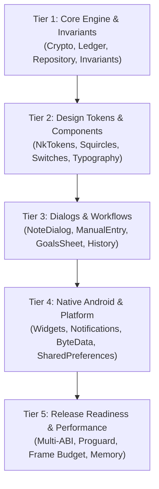

# NOTEKAR — Quality Assurance & Testing Plan

> **Quality Standard**: Zero-Lint, Zero-Warning, Zero-Regression Gate.  
> Every change to NoteKar must pass both static analysis and the automated test gauntlet before code review.

---

## 1. Automated Verification Gates

### 1.1 Gate 1: Static Analysis
```powershell
flutter analyze --fatal-infos --fatal-warnings
```
- **Requirement**: **0 issues found**. Any unused import, unawaited future, missing parameter, or deprecated API usage fails the build immediately.

### 1.2 Gate 2: Automated Test Gauntlet
```powershell
flutter test
```
- **Requirement**: **100% success rate** across all 74 test suites (559+ tests). Zero failures, zero flakes.
- **Fast Smoke Test**:
```powershell
.\scripts\test-all.ps1 -Smoke
```

### 1.3 Gate 3: Formatting & Code Style
```powershell
dart format --output=none --set-exit-if-changed lib/ test/
```
- **Requirement**: Clean format matching Dart official guidelines.

---

## 2. Multi-Tier Test Suite Structure

The NoteKar test suite in `test/` is categorized into 5 critical tiers:



### Tier 1: Core Engine & Domain Invariant Suites
| Test File | Test Focus | Key Invariants Verified |
| :--- | :--- | :--- |
| `vault_encryption_service_test.dart` | Cryptographic Vault | PBKDF2-SHA256 (100k iter) + AES-256-GCM NIST SP 800-38D, salt/IV randomness, corrupted ciphertext authentication rejection. |
| `life_ledger_timeline_test.dart` | Timeline Ledger Engine | Session boundary pairing at identical timestamp $T$, gap detection, claimed gap suppression, out-of-order moment insertion. |
| `phase1_engine_invariants_and_safety_test.dart` | Domain Invariants | SharedPreferences set conversion, non-destructive media staging, relative sandbox paths, single burst haptics. |
| `goals_engine_test.dart` | Goals & Pacing Engine | Pacing deficit calculation, target duration vs invested seconds, milestone completion status. |
| `checkpoint_habit_fixes_test.dart` | Checkpoints & Habits | Daily habit streaks, frequency validation, streak freeze mechanics. |
| `sobriety_and_eos_test.dart` | Sobriety Companion | Clean time calculations, milestone badge unlocks, urge surfing timer, relapse recovery. |

### Tier 2: Apple HIG Design System & Component Suites
| Test File | Component | Verification Criteria |
| :--- | :--- | :--- |
| `apple_hig_bitchord_precision_components_test.dart` | `NkIosSwitch`, `NkCard`, `NkButton` | Authentic kinetic spring animations, haptic triggers on flip, squircle corner curvature, inset hairline dividers. |
| `clock_format_test.dart` | `ClockFace`, Digital Chronometer | OpenType tabular figures (`.withTabularFigures()`), 12h/24h formats, zero digit jitter during rapid increments. |
| `accent_palette_test.dart` | `Palette` | Color token mapping across Light, Dark, AMOLED, E-Ink, and Matrix modes for all 7 accents. |
| `phase2_micro_typography_and_touch_comfort_test.dart` | Typography & Touch Slop | Inter typography hierarchy, negative optical tracking, 48×48dp touch targets (`NkTouchTarget.minInteractive`). |

### Tier 3: Dialog & Screen Workflow Suites
| Test File | Dialog / Screen | User Journey Tested |
| :--- | :--- | :--- |
| `home_screen_test.dart` | `NoteKarHome` | 1-tap logging, start/stop session, category pill selection, dynamic capsule header, activity ring painting. |
| `notekar_8_bugs_fixes_test.dart` | `HistoryDialog`, `MergeEntriesSheet` | Session merge, smart trim scrubber, filter drawer, search query execution, entry deletion with undo. |
| `custom_tags_and_big_note_test.dart` | `NoteDialog`, `BigNoteDialog` | Fullscreen writing, hashtag auto-complete overlay, multi-photo staging, voice note playback pill. |
| `gap_prefill_and_rest_test.dart` | `ManualEntryDialog` | Gap prefill into manual session (`lockToSession: true`), Cupertino date/time wheel picker interaction. |
| `settings_navigation_and_custom_switch_test.dart` | `SettingsDialog` | Deep sub-category navigation, search filter across settings, predictive back peek gesture. |

### Tier 4: Native Android Integration Suites
| Test File | Subsystem | Verification Criteria |
| :--- | :--- | :--- |
| `phase4_predictive_back_and_monochrome_icons_test.dart` | Native Android | Predictive back edge drag filtering (`dx <= edgeWidth`), monochrome status bar icon (`ic_stat_notekar`), notification action length (<= 8 chars). |
| `under_the_hood_upgrades_test.dart` | Memory & ByteData | ByteData offset/length slicing, memory leak prevention, low-memory mode eviction. |
| `notekar_data_safety_permissions_content_rating_test.dart` | Play Store Readiness | Runtime permissions justification, data safety audit, content rating disclosures (3+). |

---

## 3. Manual Verification Checklist Across Themes

Before any release candidate sign-off, verify visual quality across all 5 themes using the checklist below:

| Verification Item | Light Theme | Dark Theme | AMOLED Theme | E-Ink Mode | Matrix Mode |
| :--- | :---: | :---: | :---: | :---: | :---: |
| **Clock Face & Chronometer** | High contrast, no jitter | Smooth glow | Deep pitch black (#000000) | 100% black/white | Terminal green |
| **Inset Grouped Cards (`NkCard`)** | Pure white (#FFFFFF) on #F8FAFC | Elevated slate (#151C2C) | Dark gray (#121212) on #000000 | Pure border outline | CRT box border |
| **Hairline Dividers** | 0.5pt subtle alpha | 0.5pt subtle alpha | High-contrast alpha | Solid 1px black | Solid 1px green |
| **Typography Readability** | WCAG AAA contrast | WCAG AAA contrast | High contrast white on black | Crisp sharp black | Monospace green |
| **Touch Targets** | >= 48×48dp | >= 48×48dp | >= 48×48dp | >= 48×48dp | >= 48×48dp |
| **Modal Sheets** | Frosted light squircle | Deep slate squircle | Solid black squircle | Crisp white card | Framed box |

---

## 4. Edge-Case & Stress Testing Gauntlet

1. **Large Dataset Stress Test**:
   - Seed database with 10,000 synthetic moments using `GodModeSettingsPage`.
   - Verify timeline scrolling maintains 60/120 FPS without frame drops or GC pauses.
   - Verify search completes within 100ms.
2. **Crash Resilience & Circuit Breaker**:
   - Force unhandled exception; verify `setupErrorHandling()` in `main.dart` catches the error and displays the recovery screen without hard process death.
   - Verify `CircuitBreakerService` boots app in Safe Mode if 3 consecutive startup crashes occur.
3. **Storage & Permission Failure Scenarios**:
   - Deny microphone permission and trigger voice recording; verify graceful toast/sheet explanation without crash.
   - Deny camera permission and trigger photo capture; verify clear fallback to gallery or informative alert.
   - Attempt importing corrupted `.notekar-vault` file with wrong password; verify `VaultAuthException` is trapped and user receives clean error dialog.
4. **Interrupted Session & Sudden Process Termination**:
   - Start active session, kill application via Android task manager, reopen; verify live session resumes chronometer accurately from persisted start timestamp.

---

## 5. Pre-Release Build & Binary Verification

```powershell
# Execute complete verification script
.\scripts\verify.ps1

# Build release APKs with multi-ABI splits and SHA-256 checksums
.\scripts\build-release-apks.ps1
```
- Verify APK sizes are optimized (<30MB per ABI).
- Verify Proguard mapping is generated and saved.
- Verify SHA-256 checksums are computed and logged in `releases/`.
